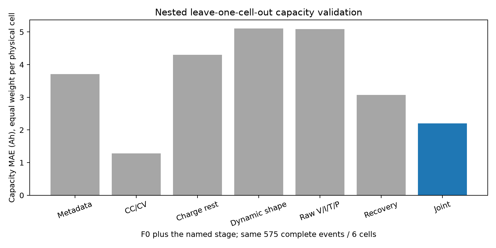
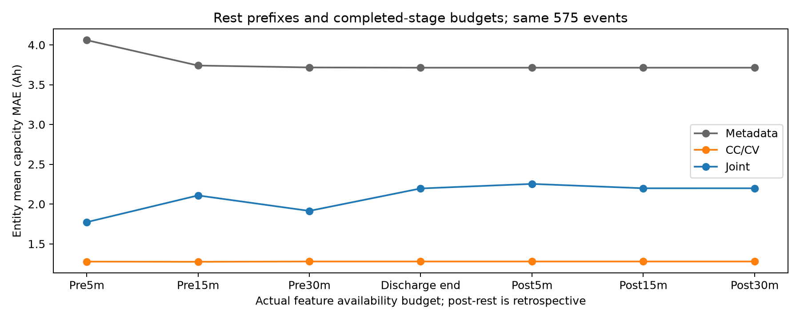
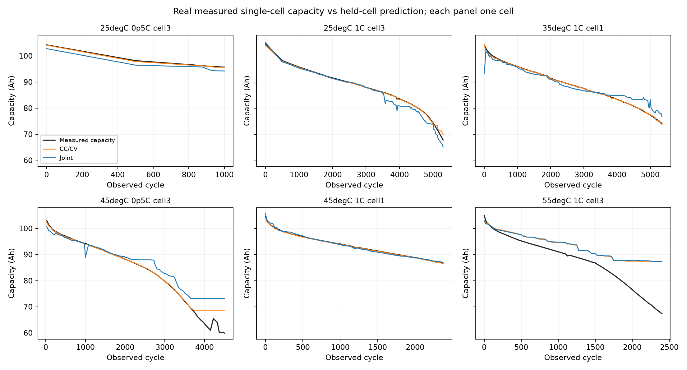

# 方案3：CCCV、静置、脉冲联合特征验证报告

执行日期：2026-10-13。最终结果为研究原型，不替换正式提交模型。源码和所有输出在独立分支/worktree；原项目 research 同名目录为指向本研究的链接。环境、输入哈希、协议、开发修正和复现命令见 execution_context.json、environment.json、source_input_manifest.json、protocol*.json、*amendment*.json、REPRODUCE.md。

## 结论先读

**不接纳当前联合特征模型作为新的容量估计主线。** 在同一575条完整事件、同一F0、同一预算、同一六芯外层留出的比较中，联合 MAE 2.199 Ah，优于F0的3.713 Ah，改善40.8%；但比最强CC/CV单阶段1.278 Ah恶化72.0%，未满足预登记的双重5%改善门。完整阶段直接覆盖81.4%，未到90%；跨温45°C/0.5C一芯恶化13.4%，未到分层≤10%要求。

严格时间前推的联合4.756 Ah，相同F0 4.785 Ah，仅改善0.6%，也未通过5%门。这个结果说明当前实现没有足够稳定的阶段增量，**不证明所有多阶段方法在所有电池上都无效**。

官方四芯只有一个物理组、后续容量未公开；源域充电终止约3.65V，官方组压/4约3.50V，且单芯0.5/1C到2.5V容量与四串C/20到11.2V不是同一目标。合法容量迁移接纳为0，**全拒绝不是稳健性通过**。没有经独立真实组验证的转换，CK1–CK7不生成新的SOH数字，真实误差留空。

两篇论文的方法/源码已核对，统计与前缀科学检查35/35通过；作者公开容量基准本次未完成：Zenodo内容成员多次HTTP Range超时，具体缺项和日志保留。不能把本地P1的Zhu风格/Gasper风格对照叫作完整论文复现。

## 数据、配对和实际预算

P1来自桌面 Current State_Challenge1 对应的六个102Ah LFP真实单芯生命周期，工作模型所读CSV位于 dataset original。不是六个真实四串组。按预登记的首/末周期及每25周期固定抽样，得到773条原始容量记录；其中67条同编号放电发生在充电之前，不能形成指定的充电→静置→紧接容量测试链，保留审计而不进入监督联合实验。合法配对706条，完整前后30min静置交集575条。一次事件四通道不扩成四个实体。

标签是实际CC放电至2.5V所得Ah；输入的放电部分只含固定早期10/30/60/300s及2/5/10Ah，不读完整放电Ah、总持续时间或截止端点来推当前标签。CCCV与静置同一物理芯、同一循环配对；不按相近容量匹配、不跨论文拼行。

P1相当多的充电从上次放空开始，完整充入Ah近似下次容量。这是合法可见信息，但**不等于官方浅充片段中已识别健康**。去掉完整充电量/总充电时长/CV Ah后，联合MAE升到3.209 Ah。其余CV时长和电流尾段仍保留，所以该对照也不是严格全量“真实20Ah浅充实验”。

F0统一包含已观察过去累计充电Ah、记录日期年龄、箱温、实际可见温度、名义充电倍率、充电时长和始末电压。没有实体ID、未知目标容量或未来循环序号。P1累计量只用物理循环顺序中已经观察的充电；官方由可见正电流按实际时间积分，重复时间和大缺口跳过。源记录45°C/0.5C有两处记录日期倒退，不能把记录年龄当高精度日历老化真值；前推训练同时满足物理周期顺序和训练容量时间早于未来测试输入，重叠的训练记录剔除。

所有主比较先按整颗物理芯划分、折内插补/标准化、内层最多3个实体折选择8个EN/小XGB配置。主指标为逐芯平均MAE再六芯等权平均；SOH pp按已知102Ah归一，MAE相对误差的分母则是各次真实容量，两者不混用。缺阶段全事件评分另列，未删除难例冒充泛化。

官方原始全文件认证41标准事件、38宽约32.9Ah事件；截至CK7只有39标准＋36宽=75事件。之后2标准/2宽不会进入CK7前缀。标准事件可配完整充电，宽事件不硬接上一段充电/长静置。重复时间戳保留原有充电/负电流/零电流阶段标记，在各阶段内去重；否则会把真正的放电末点替换成静置零电流点。registry中保留真实连续时长：1790/1799s不冒充1800s。

候选目录的事件ID仅用于研究链配对注释，不进入模型输入。另在每个查询日期先截断原始波形、再识别充电和静置，完全不读未来脉冲目录的独立重放已输出在 official_charge_rest_causal_prefix_replay.csv；与有配对目录的重叠静置统计逐条核对一致，避免依靠未来事件存在来选择在线充后特征。每条预算行保存 available_after。pre300/pre900/pre1800只使用对应长度静置；后续预算保留已完成的30min充后静置，post300/post900只缩短放后静置。F4源域是在完整参考容量测完后才可见，属于回顾诊断，不能与仅充后静置的在线查询混称一个预算。

## 特征与论文核查

F1：固定电压段ΔAh、固定Ah位置电压、完整可见充入量、CV时长/Ah/尾电流及阈值时间、有限候选单指数拟合残差。CV控制依据电流变小及距控制电压最大值10mV内；官方四通道以共同组压控制判断，不能以某芯先达到阈值判断容量大小。

F2/F4：Zhu三统计Var/Ske/Max和六统计；方差用n−1，偏度/峰度使用这个样本标准差、分子用n平均，超额峰度减3，零方差显式掩码。严格连续时间网格；P1原始静置30s，官方支持10s，不跨缺口。另含相对末端变化、末段漂移以及60/300/900/1800s候选指数时间常数、残差和边界标志。这是粗网格形状描述，不是已精确辨识电化学时间常数。

F3：工程早期响应与小型原始V/I/T/P网格分开。原始基线实际0/30/60/120/300s采样，I保留放电负号并以名义容量转倍率，T为真实观察温度，P=V−V0；PI以实际I除、零电流置数值占位0并加明确掩码。30s表观响应不称0.1/1s内阻。与Gasper的HPPC10+40+10s/快速16s激励、采样及容量标签均不同，源域风格对照不等于作者论文实验。

F5：官方每芯特征、同事件均值/标准差/极差及芯号一致性；温度是共享观测，不能计为四路温度或四个样本。组压与四芯和的差、充电结束四芯离散作为质量记录。因为没有真实组容量监督，F5容量增量一律UNVERIFIED。

Gasper代码measurement_id的50次20%分割，与整颗物理芯留出必须分开；公开基准脚本已写出两套划分并要求保存实体重叠、逐条预测、现代锁定版本完整booster参数。原baseline筛选未真正传入训练的源码问题在本项目显式处理。库默认配置的玩具烟雾fit仅验证/导出参数，绝不计容量实验。

Zhu原代码14点的真实时间跨度需读取原始CSV才能确定，不直接等同30min；容量2500–3500mAh筛选只能作为论文复核定义，不能用未知官方标签筛选。Table11固定模型6树/depth6/lr0.8，与项目调参分开。6379165与6405084是同版本文件记录，不增加数据集数量。TL1/TL2需要多条目标真容量；CK0在首次运行之前，没有配对输入，连单参数锚定都不执行。详见 paper_to_project.md 和 public_benchmark_status.json。

## 真实单芯容量结果

- Metadata：MAE 3.713 Ah；RMSE 5.519 Ah；SOH MAE 3.641 pp；最差芯平均误差 7.188 Ah。
- CC/CV：MAE 1.278 Ah；RMSE 3.450 Ah；SOH MAE 1.253 pp；最差芯平均误差 6.247 Ah。
- Charge rest：MAE 4.305 Ah；RMSE 6.076 Ah；SOH MAE 4.220 pp；最差芯平均误差 8.936 Ah。
- Dynamic shape：MAE 5.110 Ah；RMSE 6.954 Ah；SOH MAE 5.009 pp；最差芯平均误差 7.312 Ah。
- Raw V/I/T/P：MAE 5.090 Ah；RMSE 7.306 Ah；SOH MAE 4.990 pp；最差芯平均误差 8.405 Ah。
- Recovery：MAE 3.072 Ah；RMSE 4.574 Ah；SOH MAE 3.011 pp；最差芯平均误差 7.234 Ah。
- Joint：MAE 2.199 Ah；RMSE 3.973 Ah；SOH MAE 2.156 pp；最差芯平均误差 6.327 Ah。

仅Zhu三统计：MAE 5.817 Ah；六统计5.280 Ah。这是在大容量LFP源域的迁入实验，不是原NCA论文的复现值。充后静置加入共同F0后仍未改善；放后恢复有一些元数据以外信息，但预算较晚。工程放电与原始网格都没有稳定超过CC/CV。

- pre300：联合 1.773 Ah；相同F0 4.060 Ah。
- pre900：联合 2.108 Ah；相同F0 3.741 Ah。
- pre1800：联合 1.914 Ah；相同F0 3.717 Ah。
- dis_end：联合 2.196 Ah；相同F0 3.713 Ah。
- post300：联合 2.253 Ah；相同F0 3.713 Ah。
- post900：联合 2.199 Ah；相同F0 3.713 Ah。
- post1800：联合2.199 Ah；F0 3.713 Ah。

完整30min不必然优于5min：输入采样/形状/模型复杂度和源域老化差异共同决定效果。不要按本次最小数再挑“最优分钟”冒充新封存选择。

- 102Ah_25degC_0p5C_cell3：9次，MAE 1.211 Ah，末20%循环 MAE 1.482 Ah，最坏单次 1.709 Ah。
- 102Ah_25degC_1C_cell3：113次，MAE 1.232 Ah，末20%循环 MAE 2.257 Ah，最坏单次 4.343 Ah。
- 102Ah_35degC_1C_cell1：167次，MAE 1.360 Ah，末20%循环 MAE 3.426 Ah，最坏单次 10.955 Ah。
- 102Ah_45degC_0p5C_cell3：127次，MAE 2.779 Ah，末20%循环 MAE 7.658 Ah，最坏单次 13.201 Ah。
- 102Ah_45degC_1C_cell1：81次，MAE 0.283 Ah，末20%循环 MAE 0.180 Ah，最坏单次 1.142 Ah。
- 102Ah_55degC_1C_cell3：78次，MAE 6.327 Ah，末20%循环 MAE 15.796 Ah，最坏单次 19.959 Ah。

55°C芯及寿命末段是明显失败点，平均MAE不能掩盖。跨温度联合MAE 2.174 Ah，45°C/0.5C相对对应整芯留出恶化13.4%；单一温度只有一颗芯的条件与整芯留出重合，不是新增多个独立温度实体证据。前推结果已在结论给出，逐芯末期/最坏误差与调参折均保存。

全合法706条事件含折内缺失回退：联合MAE 1.584 Ah，F0 3.691 Ah，只有缺失掩码的模型7.851 Ah。100%能算数值不等于100%有直接阶段支持；与575交集评分是两种人群，不能用较低总分宣称删去难例后更好。

外层训练域拟合的全特征范围门仅保留交集的33.2%事件、4/6芯。保留样本MAE 0.742 Ah必须连同拒绝率报告；覆盖远低于90%，不接纳这个筛选版本。

## 反证、A和原N/T

按实体及年龄四分位进行训练标签置乱和形状置乱，保留可见元数据；它破坏局部信号/标签关联，不能完全破坏年龄趋势。因此只是诊断，不能代替独立组标签。逐条结果在 negative_control_predictions.csv；相同参数的阶段删除/绝对电压偏移/量化/噪声在 robustness_predictions.csv。

另对每芯预先按中位周期选一条真实原始完整链，重新抽取受扰波形：±5mV原始常量偏移、1mV量化、1mV随机噪声的最大容量预测变化分别约0.018/0.058/0.191/0.191 Ah；未改变真实测试容量。只覆盖六个代表事件，不据此宣称所有控制变化稳健。相同静置由30s改成60s网格时，平均变化1.828 Ah、最坏4.328 Ah，说明方差/偏度等对采样网格敏感。官方相同原始静置10s与30s的直接重算另保存在 sampling_10s_30s.csv。

独立解析RC发生器固定单芯参考Q=102Ah，改变SOC、温度、前置电流和传感器偏置；绝对Max与弛豫方差仍变化。它只是机制反证，不是现实恒容量实验，也不代表不均衡下四串可用Qpack恒定。真实工况匹配只能说明控制了可见条件，未知SOC/热状态/容量变化仍不能完全分离。

A分两层：最小新局部窗口趋势、以及原代码的严格20Ah末段/九电压窗/中位数滤波/温度≤5°C及电流≤20%匹配。原A的历史只取独立过去事件，不把当前波形当独立证据；原正变化率表示窗口缩小，残差输入显式反号。原A额外输入后的联合MAE 2.201 Ah，几乎没有增益；训练折内按实体OOF基础预测学习残差再评分，MAE 3.025 Ah，反而更差。不能人为把A负斜率乘成容量衰减率。简化A与原A分别留存，不互相冒名。

最早的阶段一N/T主曲线代码也按五芯训练、六芯轮流留出重拟合，MAE 1.507 Ah；未使用留出芯初始真容量做锚定。它用完整训练芯寿命标签、当前已完成的充电循环坐标和已知名义T/C，训练样本预算不同，属于历史对照，不是公平阶段增量的F0，也不是现在官方温度加权历史B的真标签。本轮联合没有理由替代它或正式B。

## 官方前缀、四芯与迁移

- CK0（2025-01-14）：可见0条事件/0条预算特征；容量接纳0条；Qpack、SOH及真实误差均留空，UNVERIFIED。
- CK1（2025-02-08）：可见8条事件/32条预算特征；容量接纳0条；Qpack、SOH及真实误差均留空，UNVERIFIED。
- CK2（2025-03-11）：可见13条事件/55条预算特征；容量接纳0条；Qpack、SOH及真实误差均留空，UNVERIFIED。
- CK3（2025-04-14）：可见25条事件/101条预算特征；容量接纳0条；Qpack、SOH及真实误差均留空，UNVERIFIED。
- CK4（2025-05-16）：可见37条事件/149条预算特征；容量接纳0条；Qpack、SOH及真实误差均留空，UNVERIFIED。
- CK5（2025-06-16）：可见49条事件/197条预算特征；容量接纳0条；Qpack、SOH及真实误差均留空，UNVERIFIED。
- CK6（2025-07-25）：可见62条事件/250条预算特征；容量接纳0条；Qpack、SOH及真实误差均留空，UNVERIFIED。
- CK7（2025-08-28）：可见75条事件/305条预算特征；容量接纳0条；Qpack、SOH及真实误差均留空，UNVERIFIED。

支持审计逐事件逐预算逐通道记录源域范围/缺阶段/充电控制/标签协议失配。每种预算均有只在源域同预算数据上拟合的模型/尺度，不要求早期查询提供未来F4。原生官方10s静置统计与源30s尚未统一，显式拒绝迁移；不能借范围接近忽略采样频率。单芯映射使用该通道实际充电始末电压，只有pack/4观察使用平均电压；3.50V是组压控制平均，不意味着四个单芯结束电压都相等。共同组端CV也不同于源域每芯独立3.65V控制。四个单芯值没有取平均或最小变成组Qpack；pack/4只是组压平均观察，不是一个独立电芯。没有可信同协议物理投影，本轮不交付新的数值转换；旧物理研究的CK0回代/模拟数值通过也不能替代真实多组容量验收。

按时间先60%训练、后40%评分，用过去完成事件预测下一标准事件组压均值30s变化这一辅助任务：元数据MAE 1.971 mV；加阶段1.984 mV；再加四芯离散2.593 mV。24训练、16测试，所有输入可用时间严格早于目标开始。本轮阶段/四芯结构没有改善辅助预测；这是一个组的时序测试，既不能证明四芯容量有效，也不能证明所有F5设计无效。仅未来波形作评分目标，不作输入或容量伪标签。

官方25/45°C分层、重复同温度特征与逐前缀轨迹已输出，升温、回温和老化同时发生，匹配后变化不能等价于恒容量或独立SOC标定。源/目标电压控制相差约150mV，远大于这里±5mV的噪声试验范围；小扰动通过不支持跨终止条件迁移。

## 接纳、未完成部分和下一步

- PASS：论文实现/代码核对，统计/分组/真实标签与波形分离/前缀检查；主联合对F0有增量。
- FAIL：联合对最强同预算单阶段5%增量；90%直接覆盖；跨温层≤10%恶化；前推联合对F0至少5%改善；官方直接接纳覆盖。
- UNVERIFIED：作者公开监督容量基准、真实四芯结构容量增量、同参考协议真实组转换与CK1–CK7误差。

作者CSV成员没有下载成功，因此50次measurement_id复核、严格整芯的公开Gasper容量回归、NCA子集Table11评分**未实际运行**。目录/大小/许可/版本/源码及可运行入口已交付；缺文件明确保存在 public_benchmark_status.json，访问失败日志在 download.log、access.log、fallback.log。本轮不宣称恢复原1.1%精度；未来取得真实成员后，必须先完成字段、实体和时间覆盖核验再评分。论文子集选择在下载/查看波形前按工况和文件编号固定，非按结果挑芯。

下一步优先做小而可判定的实验：取得相同3.50V组端控制、10s采样、真实浅充片段、重复C/20到11.2V组容量的多组LFP配对；保留温度与初态，先比较F0+一个最有希望阶段，再加联合，按物理组留出。若只能补当前组的多次容量，则只能检验该组前推，不能称跨组泛化。需要先解决目标/源输入与标签协议差异，再讨论多参数TL、四芯独立伸缩或复杂网络。

最终文件索引：label_inventory.csv / P1_pairing_audit.csv；official_registry.csv / official_missingness_by_checkpoint.csv；feature_dictionary.csv；predictions_* / entity_errors_* / tuning_*；official_checkpoint_support.json / official_support_by_event.csv；audit_checks.json / protected_files.json；源码、输入与结果SHA的各manifest。开发初步数字已单独存档，根目录为最终协议实现完成后的结果。
