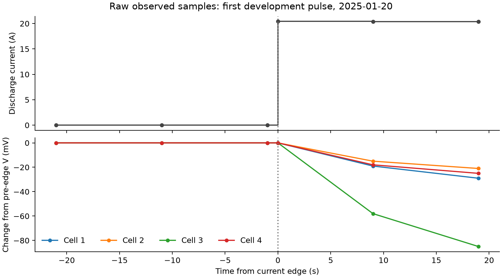
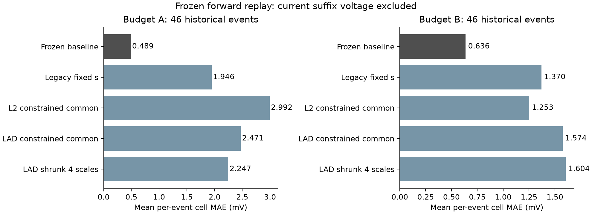
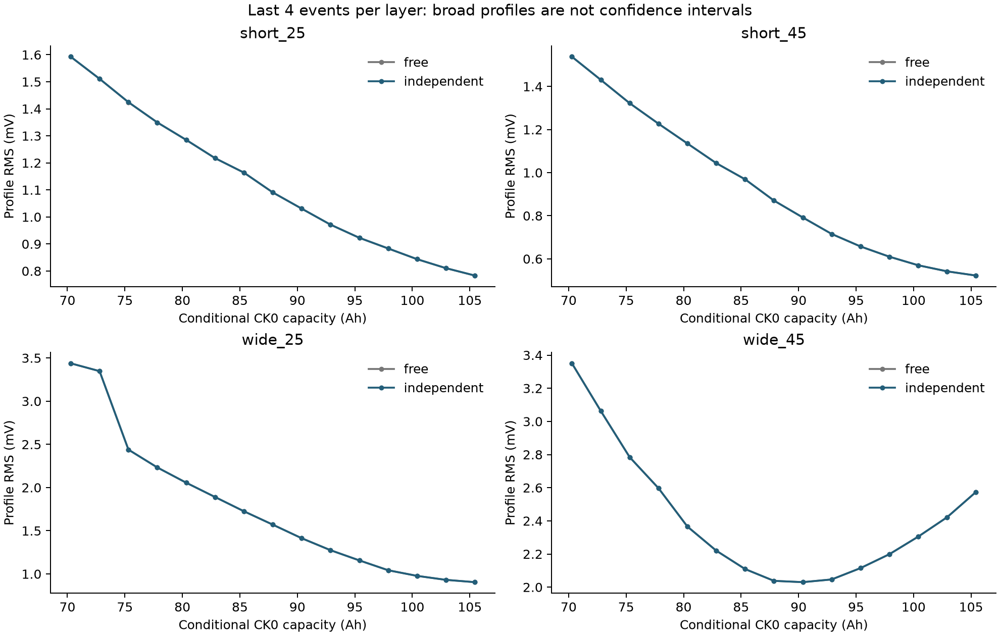

# 四篇论文迁移执行报告：implementation_v1

执行日期：2026-10-13。正式冻结规则评分已完成；旧四方法实验和正式模型未修改。

## 结论

受论文启发的电压修正、LAD/L2联合配准、多事件共同尺度和四尺度收缩分支均已实现并比较。本轮未达到可信容量更新门；四个独立尺度没有获得充分辨识证据，不发布新的CK1–CK7 SOH。门控版本全部回退到旧主基线，因此相同误差不能解释为新方法有效。

最有价值的新证据是电流边沿未提供可辨分的同步瞬时电压变化：边沿电压常与上一条相同，9–10秒后才出现可测响应。直接逐行算IR会得到接近零的错误结果；官方材料说明重复时间戳是步骤切换标记。修正后得到的仍是包含极化/SOC变化的延迟表观电阻。

## 完成范围与公平比较

- 原始再审核75条事件，29条开发、46条冻结前向评分；12个原始文件。逐事件原始积分与旧缓存最大差1.99e-13 Ah，四芯电压与时刻逐点完全一致。
- 同一已曝光物理包；不是新盲测或跨包泛化。同一个真实锚点链/物理跳变未跨开发与评分；unknown不是共同物理链，不能据名称合并。
- 四组loss/修正组合：L2/LAD × free/independent；固定、单事件共同、多事件共同、收缩四尺度、自由四尺度诊断、门控共同各分支。
- 前向A无目标放电电压，B最多首1Ah截距校准；2Ah后评分，历史参数available_after早于目标start。后静置不用于本事件预测。
- 16类机制×10固定评分种子，共160个场景—种子组合；四组合和四种状态分支共2560行指标。配对面板5类×2种子，利用前两轨迹预测第三轨迹后缀。
- 16项数值、因果、边界及缓存检查通过。105项源码/输入依赖冻结；旧主基线复现92条，最大误差差异0 mV。

## 阶段1：电压修正提供了什么

- 78个候选跳变，78个满足最终延迟响应资格。初步直接逐行计数已作开发修订，不能沿用此前17/67的数量。
- 70/78个边沿的最大四芯变化不足1mV。响应延迟9–10秒；这是测量时序证据，不是瞬时R0标定。
- 合格跳变全部来自约10Ah的恒流事件边界；较宽动态事件没有满足本轮稳定阶跃规则的跳变。以同面板、同温度、可见历史的最近8个测量约束有效R，并保留MAD和0.3mΩ膨胀。
- CK0只有已开始的5.1A放电，没有同步阶跃前零流电压，参考电阻和真实OCV不可独立拆分。模型将当前/参考极化分开，保留参考项的不确定性。

- development/pre静置：15条有效；前60%拟合后预测后40%，一阶恢复MAE 6.821 mV，末值保持 4.212 mV；逐条更优5/15。
- development/post静置：15条有效；前60%拟合后预测后40%，一阶恢复MAE 0.754 mV，末值保持 0.377 mV；逐条更优5/15。
- evaluation/pre静置：24条有效；前60%拟合后预测后40%，一阶恢复MAE 7.119 mV，末值保持 4.940 mV；逐条更优9/24。
- evaluation/post静置：24条有效；前60%拟合后预测后40%，一阶恢复MAE 0.664 mV，末值保持 0.431 mV；逐条更优9/24。
- 延迟跳变留出：48个物理跳变、192个芯—跳变；历史滚动表观R预测MAE 3.640mV，冻结开发中位数对照 3.634mV。个别零/低误差不能证明对真实R0的精度。

静置一阶模型未获得总体预测优势。仅对自身末值对照更优、时长/条件性合格的前静置施加振幅范围；不能将其渐近电压换成真实SOC。

## 阶段2–3：官方前向结果

以下为按物理事件平均的单芯MAE（mV），总分包含回退；A/B输入预算分开评价。

- `frozen_baseline`：A 0.489、B 0.636；直接覆盖A/B 100%/100%；前向接纳A/B False/False。
- `legacy_fixed`：A 1.946、B 1.370；直接覆盖A/B 100%/100%；前向接纳A/B False/False。
- `L2_free_multi_common`：A 9.098、B 1.258；直接覆盖A/B 100%/100%；前向接纳A/B False/False。
- `L2_independent_multi_common`：A 2.992、B 1.253；直接覆盖A/B 100%/100%；前向接纳A/B False/False。
- `LAD_free_multi_common`：A 7.690、B 1.550；直接覆盖A/B 100%/100%；前向接纳A/B False/False。
- `LAD_independent_multi_common`：A 2.471、B 1.574；直接覆盖A/B 100%/100%；前向接纳A/B False/False。
- `LAD_independent_multi_shrunk4`：A 2.247、B 1.604；直接覆盖A/B 100%/100%；前向接纳A/B False/False。
- `LAD_independent_gated_common`：A 0.489、B 0.636；直接覆盖A/B 0%/0%；前向接纳A/B False/False。

约束修正可以改善某些相对于本轮自由修正模型的结果，但全部主要候选仍未超过强旧基线。各温度/跨度层见forward_by_layer.csv，禁止评分后挑选最好的子层作为整体成功。

## 阶段4：可辨识性与敏感性

- short_25/L2：最佳共同s=1.050；1mV容差条件容量跨度35.14Ah；tau/偏置/采样扰动最佳投影跨度0.00Ah；辨识门False。
- short_25/LAD：最佳共同s=1.050；1mV容差条件容量跨度35.14Ah；tau/偏置/采样扰动最佳投影跨度2.51Ah；辨识门False。
- short_45/L2：最佳共同s=1.050；1mV容差条件容量跨度32.63Ah；tau/偏置/采样扰动最佳投影跨度0.00Ah；辨识门False。
- short_45/LAD：最佳共同s=1.050；1mV容差条件容量跨度35.14Ah；tau/偏置/采样扰动最佳投影跨度2.51Ah；辨识门False。
- wide_25/L2：最佳共同s=1.050；1mV容差条件容量跨度22.59Ah；tau/偏置/采样扰动最佳投影跨度5.02Ah；辨识门False。
- wide_25/LAD：最佳共同s=1.025；1mV容差条件容量跨度27.61Ah；tau/偏置/采样扰动最佳投影跨度5.02Ah；辨识门False。
- wide_45/L2：最佳共同s=0.900；1mV容差条件容量跨度30.12Ah；tau/偏置/采样扰动最佳投影跨度5.02Ah；辨识门False。
- wide_45/LAD：最佳共同s=0.925；1mV容差条件容量跨度32.63Ah；tau/偏置/采样扰动最佳投影跨度7.53Ah；辨识门False。
- short_25四维搜索：容差内35/35组；严格域容量可算3/35，其跨度25.10Ah；允许旧2Ah尾延拓的敏感性跨度25.10Ah。搜索非穷尽，未找到反例不能证明唯一性。
- short_45四维搜索：容差内35/35组；严格域容量可算3/35，其跨度25.10Ah；允许旧2Ah尾延拓的敏感性跨度25.10Ah。搜索非穷尽，未找到反例不能证明唯一性。
- wide_25四维搜索：容差内23/35组；严格域容量可算2/23，其跨度5.02Ah；允许旧2Ah尾延拓的敏感性跨度5.02Ah。搜索非穷尽，未找到反例不能证明唯一性。
- wide_45四维搜索：容差内35/35组；严格域容量可算3/35，其跨度20.08Ah；允许旧2Ah尾延拓的敏感性跨度20.08Ah。搜索非穷尽，未找到反例不能证明唯一性。

以上条件范围不叫95%置信区间。最后四事件的free/independent剖面仍重合：恒流时b−I_D*R只提供一个电压截距，电阻约束可以被未知偏置补偿；较宽事件又没有合格独立跳变或长静置。多事件降低噪声，并不会自动消除共同的起点、电压偏置、参考极化或温度假设。收缩四尺度的稳定性包含先验贡献，不能作为四个独立容量已被数据识别的证明。

## 独立机制验证

下列均为共同尺度分支；有信息正例是60Ah，负例定义为物理容量参数不变，负例仍可能因起点/温度/协议变化而改变可用包容量。

- L2/free：正例尺度MAE 0.0096，95分位 0.0172，最坏 0.0207；接受90%。恒容量负例110个、接受0个，错误接受总率0.0%；严格容量输出覆盖100.0%。机制门True。
- L2/independent：正例尺度MAE 0.0096，95分位 0.0172，最坏 0.0207；接受90%。恒容量负例110个、接受0个，错误接受总率0.0%；严格容量输出覆盖100.0%。机制门True。
- LAD/free：正例尺度MAE 0.0082，95分位 0.0132，最坏 0.0136；接受10%。恒容量负例110个、接受0个，错误接受总率0.0%；严格容量输出覆盖100.0%。机制门False。
- LAD/independent：正例尺度MAE 0.0082，95分位 0.0132，最坏 0.0136；接受10%。恒容量负例110个、接受0个，错误接受总率0.0%；严格容量输出覆盖100.0%。机制门False。

机制条件下的参数恢复收益与正式接纳分开。拒绝没有算成容量准确；严格投影越域均留空。生成器与拟合器不同，但它仍是固定机制模拟，不替代真实电池标签。

配对轨迹面板使用真实可见的操作净Ah传播起点，不读取真实初始SOC或目标后缀。逐行结果见paired_evaluation_metrics.csv；下面的总体均值仅为小样本描述：

- multi_common：尺度MAE 0.0703；B前向MAE 1.533mV；有效输出8/10。
- multi_shrunk4：尺度MAE 0.0853；B前向MAE 1.572mV；有效输出8/10。
- single_common：尺度MAE 0.1378；B前向MAE 2.320mV；有效输出8/10。

## 阶段5：容量投影

原有历史充电量＋温度加权B已作为独立先验基线登记到history_B_prior_baseline.csv及指纹文件；它没有用于本轮电压拟合、门控或真值。现有CK7基线为95.341%（97.248Ah），只是旧预测，缺隐藏标签不能与新曲线模型排名容量精度。

已核对CK0发布100.41Ah及5.1A、包端首次11.2V的规则。共同尺度在参考d=0、无额外压降的假设下对应Q=s×100.41，计算恒等检查通过。保存了每个历史窗口的条件容量范围，但辨识门未通过，不作为新的检查点SOH。
四尺度投影采用严格模板域，任何芯先越域都拒绝；旧2Ah尾延拓仅另列敏感性。官方材料已确认满充后5.1A放电至11.2V，但没有明示检查点充电末电流、均衡方式、静置时长、逐芯起点和参考温度，不能把运行事件d带入满充检查点，也不能用历史B输出作真值。

## 阶段6：Sun方法的适用条件

已对CK0带载曲线用11/21/41点平滑审核dV/dQ极值并保存特征目录。约10Ah事件虽为恒流，但约20.4A（相对102Ah约0.2C），与CK0约0.05C不同；较宽事件是变流运行。当前没有可认证的后续低倍率完整单芯OCV曲线，无法验证老化特征对应规律。
Sun完整变换公式仍未取得，故完成特征可行性审核后保留此分支为条件不满足；没有编造MPGA/重构公式。特征目录是带载导数，不能标成已确认电化学ICA路标。

## 四层结论与下一步

1. 可保留：同步时序核对、延迟表观电阻记录、静置恢复诊断、LAD/L2对照、条件剖面和门控拒绝。它们具有研究用途；修正模块总体预测增益尚未通过。
2. 共同尺度仍缺可靠辨识，四尺度没有获得可信增量；初始状态继续用参考Ah位置，无需人为分成SOC档位。
3. 可做清楚假设下的包级条件投影；尚不能接纳为可靠实际检查点容量预测。
4. 缺少独立逐芯SOC与CK1–CK7同协议容量标签，真实SOC/SOH精度不可测。
下一步最有价值的是补一条独立、同协议、宽跨度的低倍率检查记录：明确充电终止/均衡/静置条件，保存同步四芯电压、电流和温度，并覆盖明显曲率或末端区间；至少提供一个独立实际容量标签。若采用电流中断法，电压采样必须真正同步、足够快，不能继续把现有9–10秒延迟观测当作瞬时IR。
这一信息能同时检验CK0压缩假设、约束起点/电压修正，并评价容量真值；仅再增加短平台片段、优化器或自由参数无法补足这些约束。

## 文献与实现边界

- [Liu 2022](https://www.sciencedirect.com/science/article/pii/S2590116822000108)：借用LAD与物理曲线变换，未取得完整方法章节。
- [Tsai & Chen 2023](https://www.sciencedirect.com/science/article/pii/S2352152X22024914)：借用电流中断校准思路，未搬用NMC多项式或未知修正公式。
- [Sun 2022](https://www.sciencedirect.com/science/article/pii/S0360544221031315)：完成特征可行性审核，完整重构公式缺失。
- [Wang 2025完整预印本](https://arxiv.org/html/2511.06989v1)：借用联合起点/容量配准；本项目仍是带载模板，未满足独立OCV前提。

开发修订的早期输出单独保存。冻结后的模块重名导入问题以指定绝对路径加载同一冻结执行器解决，记录于runtime_import_audit.json；未改变模型、阈值、种子或评分。

复现方法、数据文件和完成标记见README.md。

## 评分后补充：现有45–50Ah片段

补审发现CK7前还存在419条动态放电，其中107条>40Ah、70条>45Ah。全部70条重新审核，28条开发、42条前向评分。选择窗口发生在主评分后，属于明确标注的探索性验证，不改变主接纳结论。

沿用已冻结模型、网格、tau与门槛；按温度和45.7/50.22Ah重复程序分组。程序分类来自事件目录积分跨度，因此结果条件于已知放电程序，不声称未知调度下的纯在线预测。新补充源码与协议在读取新电压结果前另存指纹。

- L2共同尺度A/B：0.865/1.258mV；历史曲线基线 0.274/0.278mV。
- LAD共同尺度A/B：0.846/1.339mV；历史曲线基线 0.274/0.278mV。
- 条件容量跨度12.55–27.61Ah，0/84个损失—历史窗口通过辨识门；门控全部回退。

更宽运行片段提供了一些约束，但现有45–50Ah记录仍不能可靠确定尺度。不是因为没有查找更宽现有记录；进一步研究应关注独立起点/电压标尺与明显曲率覆盖，而非仅把33Ah窗口换成50Ah。详细结果见supplement_wide50/summary.csv、identifiability.csv及PROTOCOL.md。
