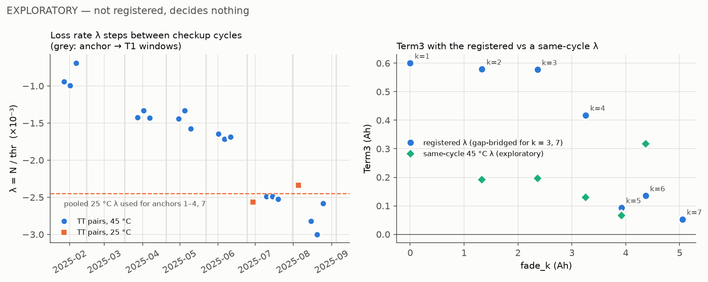
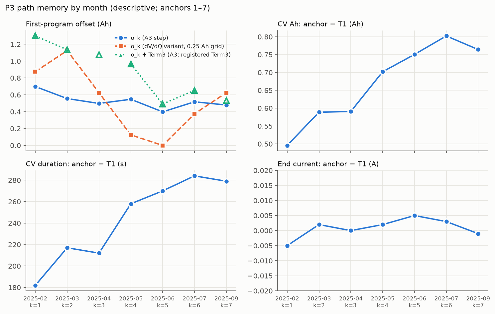
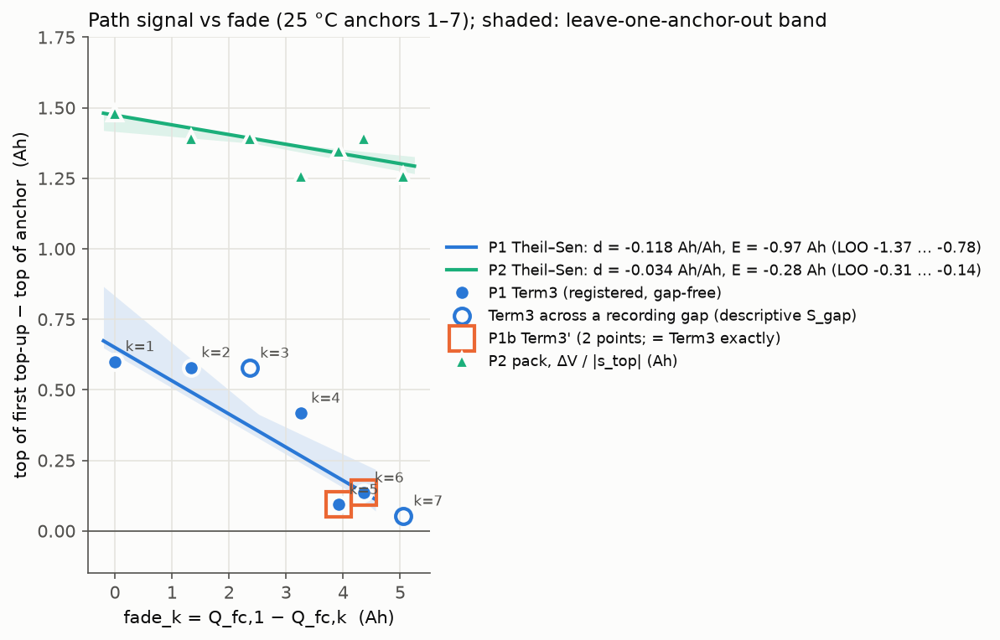

# Round 14 WP2 — Measurements: report

> **Language:** English · [中文](#zh)

Computed with the code registered at `46f3c26` (`wp1/protocol.json`); drivers `src/wp2_measure.py` and `src/wp2_figures.py`. The exploratory part (§4) uses `src/wp2_explore.py`; it is **not registered and decides nothing**. No proxy label P_k was used.

## Conclusions

1. **Registered P1 falls steeply with fade, but the trend is not identifiable.**
   - Term3_k (Ah) for anchors 1, 2, 4, 5, 6 is +0.600, +0.579, +0.418, +0.093, +0.135. Anchors 3 and 7 are excluded by the gap rule.
   - **d_path = −0.118 Ah/Ah, E = −0.97 Ah.** The LOO range of E is −1.37 … −0.78 Ah, which is **0.59 Ah wide**, against a 0.30 Ah limit. ΔBIC = +7.2 favours the linear model. No outliers.
   - The slope against time is −0.0030 Ah/day.
2. **The noise gate passes.** σ_TT,25 = 0.062 Ah (reduced reading) and 0.125 Ah (full reading); the gate value is **0.125 Ah ≤ 0.30**. σ_TT,45 = 0.032 Ah.
3. **P1b is not estimable** (2 points, anchors 5 and 6), and Term3' − Term3 = 0 exactly, as registered.
4. **The P1 trend is mostly a λ artefact (exploratory).**
   - The loss rate λ = N/thr of top-up → top-up pairs is flat within each segment, but it **steps between checkup cycles**. At 45 °C: −0.94, −1.42, −1.44, −1.69, −2.49, −2.82 ×10⁻³ for the cycles after CK0, CK2, CK3, CK4, CK5, CK6.
   - The two 25 °C TT pairs (−2.56 and −2.34 ×10⁻³, July and August) lie on the same time track.
   - The registered pooled 25 °C λ (−2.45 ×10⁻³) therefore comes only from the July/August cycles. Applied to anchors 2–4, it **over-corrects them by +0.29 … +0.39 Ah**.
   - **With the λ of the same cycle's 45 °C segment, Term3 shows no trend:** +0.19, (+0.20 across a gap), +0.13, +0.07, +0.32 Ah for anchors 2–6. That gives d = +0.005 Ah/Ah (4 gap-free points, E ≈ +0.04 Ah), or −0.014 Ah/Ah when the gap-bridged anchor 3 is included (E ≈ −0.11 Ah).
5. **P2 (voltage, independent of λ) shows only a small decline, and it comes from one cell.**
   - Pack ΔV falls from 33 to 28 mV, giving d = −0.034 Ah/Ah and E = −0.28 Ah (LOO −0.31 … −0.14 Ah), with ΔBIC = +3.7.
   - The whole trend is **cell 3** (14 → 9 mV). Cells 1, 2 and 4 are flat: Theil–Sen 0.0 mV per Ah of fade.
   - Converted to Ah, P2 is 1.26–1.48 Ah, 2.5–15 times the Ah-chain level. The CK0 C/20 slope (pack −22 mV/Ah, of which cell 3 contributes −18) does not map the relaxed top-voltage gap onto charge. P2 is therefore a **sign and trend check only**.
6. **The deferred WP0 facts are verified.**
   - The per-block balance between consecutive CV ends does not close: TT N = −0.26 … −1.13 Ah per block at 45 °C and −0.88 / −0.97 Ah at 25 °C.
   - The top-up excess ≈ +0.1 Ah holds where λ is the segment's own (anchors 5, 6: +0.09, +0.14 Ah). With the pooled λ it reads +0.42 … +0.60 Ah (anchors 1, 2, 4).
7. **Round 12 cross-check.**
   - Round 12's `wp3/pairs.csv` is **not available** on origin.
   - Descriptive check instead: running round 12's registered `ahchain.py` (now on origin) on our events gives **identical N on all 27 shared pairs** (max |ΔN| = 0.000 Ah) and the same admissibility.
   - One pair (segment 1, T3 → T4) is only ours. Round 12 drops pairs that straddle a checkup *date*, and the CK1 date (2025-02-08 00:00) falls inside segment 1, whose data run to 15:35 that day.

## 1. Ah chain and λ

| Segment | Set point | λ (×10⁻³) | Source | Gap-free TT pairs |
|---|---|---|---|---|
| 1 | 45 | −0.942 | segment | 3 |
| 2, 4, 6, 8, 14 | 25 | −2.451 | pooled 25 °C (segments 10, 12) | 0 |
| 5 / 7 / 9 / 11 / 13 | 45 | −1.424 / −1.442 / −1.688 / −2.489 / −2.823 | segment | 3 each |
| 10 / 12 | 25 | −2.562 / −2.339 | segment | 1 each |

Leave-one-out TT residuals at 25 °C: the reduced reading gives −0.359 and −0.275 Ah (λ falls back to the pooled 45 °C value, −1.611 ×10⁻³); the full reading gives −0.084 and +0.084 Ah. Every pair has thr ≈ 377.4 Ah per block (754.8 Ah for A → T2).

## 2. Signals per anchor

| k | Seg | fade (Ah) | N(A→T1) | λ source | **Term3 (P1)** | Term3' (P1b) | S_gap | ΔV pack (mV) | P2 pack (Ah) |
|---|---|---|---|---|---|---|---|---|---|
| 0 (45 °C) | 1 | −3.12 | −0.440 | segment | −0.085 (separate) | −0.085 | −0.085 | −62 | −2.78 |
| 1 | 2 | 0.00 | −0.325 | pooled 25 | **+0.600** | — | +0.600 | 33 | 1.48 |
| 2 | 4 | 1.33 | −0.346 | pooled 25 | **+0.579** | — | +0.579 | 31 | 1.39 |
| 3 | 6 | 2.36 | −0.348 | pooled 25 | excluded (2 gaps, 73 036 s) | — | +0.577 | 31 | 1.39 |
| 4 | 8 | 3.26 | −0.507 | pooled 25 | **+0.418** | — | +0.418 | 28 | 1.26 |
| 5 | 10 | 3.92 | −0.874 | segment | **+0.093** | +0.093 | +0.093 | 30 | 1.35 |
| 6 | 12 | 4.37 | −0.748 | segment | **+0.135** | +0.135 | +0.135 | 31 | 1.39 |
| 7 | 14 | 5.05 | −0.872 | pooled 25 | excluded (1 gap, 1 753 s) | — | +0.053 | 28 | 1.26 |

## 3. Registered statistics

| Signal | n | d (Ah/Ah) | E (Ah) | LOO range of E (Ah) | width | ΔBIC (const − lin) | days slope (Ah/day) | outliers |
|---|---|---|---|---|---|---|---|---|
| **P1** | 5 | **−0.118** | **−0.97** | −1.37 … −0.78 | **0.59** | +7.2 | −0.0030 | none |
| P1b | 2 | not estimable | | | | | | |
| P2 pack (Ah) | 7 | −0.034 | −0.28 | −0.31 … −0.14 | 0.17 | +3.7 | −0.0008 | none |
| S_gap (descriptive) | 7 | −0.129 | −1.06 | −1.46 … −0.99 | 0.47 | +9.7 | −0.0031 | none |
| P2 cell mean (descriptive) | 7 | −0.014 | −0.11 | −0.29 … −0.02 | 0.27 | −1.3 | −0.0004 | 3, 4 |

- **Sensitivities.** For P1, "without anchor 3" equals the main estimate, because anchor 3 is already excluded. For P2, without anchor 3, d = −0.034. For S_gap, without anchor 3, d = −0.121. P2 cell mean without its outliers (3, 4): d = −0.018.
- **P1 LOO.** Dropping anchor 1 gives E = −1.37 Ah, dropping 2 or 4 gives −0.97, dropping 5 gives −0.78, and dropping 6 gives −0.87 Ah.

## 4. Exploratory: λ is month-specific (not registered, decides nothing)

- **Within a segment, λ is stable:** the spread is 0.01–0.16 Ah per block. Between checkup cycles it steps. The largest steps are between the CK0 and CK2 cycles (−0.48 ×10⁻³; the CK1 cycle has no visible 45 °C segment) and between the CK4 and CK5 cycles (−0.80 ×10⁻³).
- The 25 °C TT values match the same-cycle 45 °C value to within −0.03 Ah per block in segment 10 and +0.18 Ah in segment 12. That bounds the error of borrowing a same-cycle λ.
- **Same-cycle Term3** (`explore_same_cycle_term3.csv`):
  - Anchor 1 has none, because its cycle's 45 °C segment (segment 3) is missing; anchor 7 has none, because no 45 °C segment follows.
  - The registered λ exceeds the same-cycle λ by 0.39, 0.38, 0.29, 0.03 and −0.18 Ah for anchors 2, 3, 4, 5 and 6. This is exactly the pattern of the registered trend.
- The reason for the steps (cycler current-measurement offset or gain, recalibration at checkups) is not identifiable from the data. Physical coulombic loss would make N > 0, not < 0.

## 5. P3 path memory (descriptive)

- **o_k = D1 − D2.**
  - A3: +0.40 … +0.70 Ah, median +0.52.
  - dV/dQ variant: 0 … +1.13 Ah, median +0.63, on a 0.25 Ah grid, so it is coarse and noisy.
  - Absolute shift o_k + Term3 (A3): +0.49 … +1.30 Ah. It inherits P1's λ artefact.
- **CV phase.** The anchor's CV phase gets longer with age relative to T1:
  - ΔCV Ah = +0.50 → +0.80 Ah;
  - ΔCV duration = +182 → +284 s;
  - the end currents agree to within ±0.005 A, so both charges stop at the same 5.1 A cutoff.

## 6. Figure 1

## Files

| File | Content |
|---|---|
| `events.csv` | all 41 CV ends (kind A/T, anchor k, row, set point, Q_fc) |
| `pairs.csv` | every AT1 / AT2 / TT pair: N, thr, gaps, λ, offset, TT LOO residuals (both readings) |
| `lambda.csv` | λ per segment and its source |
| `term3.csv` | per anchor: Term3, Term3', S_gap, fade, days, P2 |
| `p2_voltage.csv` | V30 of A and T1, ΔV (mV) and P2 (Ah), pack and cells |
| `p3_memory.csv` | o_k (A3, dV/dQ), absolute shift, CV differences |
| `stats.json` | registered statistics for P1, P1b, P2, S_gap, P2 cell mean; σ_TT; s_top; round 12 cross-check |
| `r12_ahchain_crosscheck.csv` | descriptive N comparison with round 12's registered `ahchain.py` |
| `explore_*.csv`, `explore.json`, `fig3_explore_lambda.png` | exploratory λ analysis (not registered) |
| `fig1_term3_vs_fade.png`, `fig2_p3_vs_month.png` | the two required figures |

---

# 第 14 轮 WP2 — 测量：报告

> [English](#en) · 中文

使用 `46f3c26` 登记的代码（`wp1/protocol.json`）计算；驱动脚本为 `src/wp2_measure.py` 和 `src/wp2_figures.py`。探索性部分（第 4 节）使用 `src/wp2_explore.py`，**未登记，不做任何决定**。没有使用任何代理标签 P_k。

## 结论

1. **登记的 P1 随衰减急剧下降，但这个趋势无法识别。**
   - 锚点 1、2、4、5、6 的 Term3_k（Ah）为 +0.600、+0.579、+0.418、+0.093、+0.135。锚点 3 和 7 被间隙规则排除。
   - **d_path = −0.118 Ah/Ah，E = −0.97 Ah。** E 的 LOO 范围为 −1.37 … −0.78 Ah，**宽 0.59 Ah**，上限为 0.30 Ah。ΔBIC = +7.2，偏好线性模型。没有离群点。
   - 对时间的斜率为 −0.0030 Ah/天。
2. **噪声门通过。** σ_TT,25 = 0.062 Ah（缩减读法）和 0.125 Ah（全集读法）；噪声门取值 **0.125 Ah ≤ 0.30**。σ_TT,45 = 0.032 Ah。
3. **P1b 无法估计**（2 个点：锚点 5、6），且 Term3' − Term3 恰好为 0，与登记时的预期一致。
4. **P1 的趋势主要是 λ 造成的假象（探索性）。**
   - 补电 → 补电配对的损耗率 λ = N/thr 在每一段内都很平稳，但**在检查周期之间跳变**。45 °C 时：CK0、CK2、CK3、CK4、CK5、CK6 之后各周期分别为 −0.94、−1.42、−1.44、−1.69、−2.49、−2.82 ×10⁻³。
   - 25 °C 的两个 TT 配对（−2.56 和 −2.34 ×10⁻³，7 月和 8 月）落在同一条时间轨迹上。
   - 因此登记的 25 °C 合并 λ（−2.45 ×10⁻³）只来自 7、8 月的周期。用到锚点 2–4 上，会**把它们多修正 +0.29 … +0.39 Ah**。
   - **改用同一周期 45 °C 段的 λ 后，Term3 没有趋势：** 锚点 2–6 依次为 +0.19、（跨间隙 +0.20）、+0.13、+0.07、+0.32 Ah。由此 d = +0.005 Ah/Ah（4 个无间隙点，E ≈ +0.04 Ah）；纳入跨间隙的锚点 3 时为 −0.014 Ah/Ah（E ≈ −0.11 Ah）。
5. **P2（电压信号，不依赖 λ）只有很小的下降，而且来自单个电芯。**
   - 电池组 ΔV 从 33 mV 降到 28 mV，得到 d = −0.034 Ah/Ah、E = −0.28 Ah（LOO −0.31 … −0.14 Ah），ΔBIC = +3.7。
   - 整个趋势来自**电芯 3**（14 → 9 mV）。电芯 1、2、4 都是平的：Theil–Sen 斜率为每 Ah 衰减 0.0 mV。
   - 换算成 Ah 后 P2 为 1.26–1.48 Ah，是电量链水平的 2.5–15 倍。CK0 C/20 曲线的斜率（电池组 −22 mV/Ah，其中电芯 3 贡献 −18）无法把静置后的顶部电压差映射成电量。所以 P2 **只用来检验符号和趋势**。
6. **WP0 推迟的事实已核实。**
   - 相邻 CV 结束之间的逐块对账不闭合：45 °C 时 TT 的 N 为每块 −0.26 … −1.13 Ah，25 °C 时为 −0.88 / −0.97 Ah。
   - 补电多充约 +0.1 Ah 在 λ 取本段值时成立（锚点 5、6：+0.09、+0.14 Ah）。用合并 λ 时读数为 +0.42 … +0.60 Ah（锚点 1、2、4）。
7. **与第 12 轮交叉核对。**
   - 第 12 轮的 `wp3/pairs.csv` 在 origin 上**不可用**。
   - 改做描述性核对：在我们的事件上运行第 12 轮已登记的 `ahchain.py`（现已在 origin 上），**全部 27 个共有配对的 N 完全相同**（最大 |ΔN| = 0.000 Ah），可用性判定也相同。
   - 有一个配对（第 1 段 T3 → T4）只在我们这边。第 12 轮会去掉跨越检查*日期*的配对，而 CK1 的日期（2025-02-08 00:00）落在第 1 段内部，该段数据一直到当天 15:35。

## 1. 电量链与 λ

| 段 | 设定温度 | λ（×10⁻³） | 来源 | 无间隙 TT 配对数 |
|---|---|---|---|---|
| 1 | 45 | −0.942 | 本段 | 3 |
| 2、4、6、8、14 | 25 | −2.451 | 25 °C 合并（第 10、12 段） | 0 |
| 5 / 7 / 9 / 11 / 13 | 45 | −1.424 / −1.442 / −1.688 / −2.489 / −2.823 | 本段 | 各 3 |
| 10 / 12 | 25 | −2.562 / −2.339 | 本段 | 各 1 |

25 °C 的留一 TT 残差：缩减读法为 −0.359 和 −0.275 Ah（λ 退回到 45 °C 合并值 −1.611 ×10⁻³）；全集读法为 −0.084 和 +0.084 Ah。每个配对的 thr 都约为每块 377.4 Ah（A → T2 为 754.8 Ah）。

## 2. 各锚点的信号

| k | 段 | 衰减（Ah） | N(A→T1) | λ 来源 | **Term3（P1）** | Term3'（P1b） | S_gap | 电池组 ΔV（mV） | P2 电池组（Ah） |
|---|---|---|---|---|---|---|---|---|---|
| 0（45 °C） | 1 | −3.12 | −0.440 | 本段 | −0.085（单独报告） | −0.085 | −0.085 | −62 | −2.78 |
| 1 | 2 | 0.00 | −0.325 | 25 °C 合并 | **+0.600** | — | +0.600 | 33 | 1.48 |
| 2 | 4 | 1.33 | −0.346 | 25 °C 合并 | **+0.579** | — | +0.579 | 31 | 1.39 |
| 3 | 6 | 2.36 | −0.348 | 25 °C 合并 | 排除（2 个间隙，73 036 s） | — | +0.577 | 31 | 1.39 |
| 4 | 8 | 3.26 | −0.507 | 25 °C 合并 | **+0.418** | — | +0.418 | 28 | 1.26 |
| 5 | 10 | 3.92 | −0.874 | 本段 | **+0.093** | +0.093 | +0.093 | 30 | 1.35 |
| 6 | 12 | 4.37 | −0.748 | 本段 | **+0.135** | +0.135 | +0.135 | 31 | 1.39 |
| 7 | 14 | 5.05 | −0.872 | 25 °C 合并 | 排除（1 个间隙，1 753 s） | — | +0.053 | 28 | 1.26 |

## 3. 登记的统计结果

| 信号 | n | d（Ah/Ah） | E（Ah） | E 的 LOO 范围（Ah） | 宽度 | ΔBIC（常数 − 线性） | 天数斜率（Ah/天） | 离群点 |
|---|---|---|---|---|---|---|---|---|
| **P1** | 5 | **−0.118** | **−0.97** | −1.37 … −0.78 | **0.59** | +7.2 | −0.0030 | 无 |
| P1b | 2 | 无法估计 | | | | | | |
| P2 电池组（Ah） | 7 | −0.034 | −0.28 | −0.31 … −0.14 | 0.17 | +3.7 | −0.0008 | 无 |
| S_gap（描述性） | 7 | −0.129 | −1.06 | −1.46 … −0.99 | 0.47 | +9.7 | −0.0031 | 无 |
| P2 电芯平均（描述性） | 7 | −0.014 | −0.11 | −0.29 … −0.02 | 0.27 | −1.3 | −0.0004 | 3、4 |

- **敏感性分析。** P1 的"去掉锚点 3"与主估计相同，因为锚点 3 本来就被排除了。P2 去掉锚点 3 后 d = −0.034。S_gap 去掉锚点 3 后 d = −0.121。P2 电芯平均去掉离群点（3、4）后 d = −0.018。
- **P1 的留一结果。** 去掉锚点 1 时 E = −1.37 Ah，去掉 2 或 4 时为 −0.97，去掉 5 时为 −0.78，去掉 6 时为 −0.87 Ah。

## 4. 探索性：λ 按月不同（未登记，不做任何决定）

- **段内的 λ 很稳定：** 每块的离散在 0.01–0.16 Ah。检查周期之间则会跳变。最大的跳变在 CK0 与 CK2 周期之间（−0.48 ×10⁻³；CK1 周期没有可见的 45 °C 段），以及 CK4 与 CK5 周期之间（−0.80 ×10⁻³）。
- 25 °C 的 TT 值与同周期 45 °C 的值相差：第 10 段每块 −0.03 Ah，第 12 段每块 +0.18 Ah。这给出了借用同周期 λ 的误差界。
- **同周期 Term3**（`explore_same_cycle_term3.csv`）：
  - 锚点 1 没有同周期值，因为它所在周期的 45 °C 段（第 3 段）缺失；锚点 7 也没有，因为它之后没有 45 °C 段。
  - 登记 λ 比同周期 λ 多修正：锚点 2、3、4、5、6 依次为 0.39、0.38、0.29、0.03、−0.18 Ah。这恰好就是登记趋势的形态。
- 跳变的原因（循环仪电流测量的偏置或增益、检查时的重新标定）无法从数据中识别。真实的库仑损耗会使 N > 0，而不是 < 0。

## 5. P3 路径记忆（描述性）

- **o_k = D1 − D2。**
  - A3：+0.40 … +0.70 Ah，中位数 +0.52。
  - dV/dQ 变体：0 … +1.13 Ah，中位数 +0.63，位于 0.25 Ah 网格上，所以粗糙且噪声大。
  - 绝对位移 o_k + Term3（A3）：+0.49 … +1.30 Ah。它继承了 P1 的 λ 假象。
- **CV 阶段。** 随老化，锚点的 CV 阶段相对 T1 越来越长：
  - ΔCV 电量 = +0.50 → +0.80 Ah；
  - ΔCV 时长 = +182 → +284 s；
  - 末电流相差在 ±0.005 A 以内，所以两次充电都停在同一个 5.1 A 截止点。

## 6. 图 1

## 文件

| 文件 | 内容 |
|---|---|
| `events.csv` | 全部 41 个 CV 结束（类型 A/T、锚点 k、行号、设定温度、Q_fc） |
| `pairs.csv` | 每个 AT1 / AT2 / TT 配对：N、thr、间隙、λ、偏移、TT 留一残差（两种读法） |
| `lambda.csv` | 各段的 λ 及其来源 |
| `term3.csv` | 每个锚点：Term3、Term3'、S_gap、衰减、天数、P2 |
| `p2_voltage.csv` | A 与 T1 的 V30、ΔV（mV）和 P2（Ah），电池组和各电芯 |
| `p3_memory.csv` | o_k（A3、dV/dQ）、绝对位移、CV 差 |
| `stats.json` | P1、P1b、P2、S_gap、P2 电芯平均的登记统计；σ_TT；s_top；第 12 轮交叉核对 |
| `r12_ahchain_crosscheck.csv` | 与第 12 轮已登记 `ahchain.py` 的描述性 N 比较 |
| `explore_*.csv`、`explore.json`、`fig3_explore_lambda.png` | 探索性 λ 分析（未登记） |
| `fig1_term3_vs_fade.png`、`fig2_p3_vs_month.png` | 两张要求的图 |
