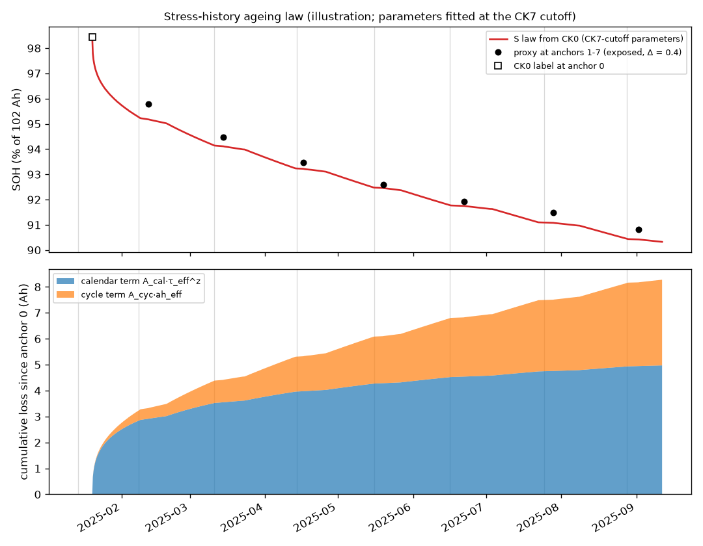

<a id="en"></a>

# Round 5A: Self-Calibrated Stress-History Ageing Model — Final Report

> **Language:** English · [中文](#zh)

- **Run:** 2026-10-14, unattended, following [EXECUTION_PROMPT.md](EXECUTION_PROMPT.md).
- **Where:** worktree `/Users/shane/Desktop/Arena_1014_r5a_stress`, branch `exp/phase2-r5a-stress-model-20261014`.
- **Exposure:** every result is **exposed-exploratory**. All CK1–CK7 proxy values had been seen before, and the proxies (post-checkup full charge + ε) are not hidden C/20 truth.
- **Untouched:** the submission package and every earlier study.

## Conclusions first

1. **No model passes every gate, so V2 stays the leading research candidate.** No candidate class was produced, and nothing was wired into `my_model/`.
2. **The stress model S_main tracks the pack well once it has anchors, but fails at CK1, where it has none.**
   - From CK3 to CK7 its errors are −0.03, −0.00, −0.16, −0.37 and +0.03 pp.
   - Its ε-free CK2–7 MAE is 0.192 pp (V2 0.216), and its pseudo-scenario MAE is 0.131 pp (V2 0.240).
   - At CK1 no anchor pair is visible, so the prediction is the prior alone. The literature-derived prior over-predicts the first month's loss by about 1.2 Ah, which gives −1.13 pp at CK1.
   - That one point makes S_main fail G-proxy (MAE 0.326 at Δ = 0.4), G-regress and G-robust.
3. **The fixed-weight ensemble ENS50 is the closest miss.**
   - MAE is 0.158 / 0.214 / 0.270 pp at Δ = 0 / 0.4 / 0.8 (V2: 0.272 / 0.216 / 0.210), MAX 0.617 pp at Δ = 0.4, and ε-free MAE 0.173 pp.
   - It fails G-proxy only because the errors of S and V2 shift in opposite directions with Δ: at Δ = 0.8 its MAE (0.270) and MAX (0.851) exceed V2's.
4. **CK2 (H-A): supported in direction, weak in size, inconclusive as evidence.**
   - The sublinear law lowers CK2 from +0.669 (V2) to +0.565 pp without the over-correction of linear extrapolation (z = 1: −2.13; round 3 D1/D2: −1.43 / −1.05).
   - The extrapolation of the missing segment 3 is accurate (+3 % in Ah, −0.013 pp effect). The remaining error comes from the law's shape: z = 0.5 would give −0.21 pp. A single exposed point cannot decide z.
5. **Independence (H-B): partly.** The S and V2 errors correlate at 0.44 over seven exposed checkups. The ensemble helps at small Δ but not robustly across ε assumptions.
6. **Interpretability (H-C): limited.**
   - After CK2 the fitted law is stable: A_cal = 1.61–1.74 Ah/d^0.2, A_cyc = 4.8–6.2 × 10⁻⁵ per Arrhenius-weighted Ah, and the anchor-0 temperature offset is −0.08 to −0.14 Ah.
   - The calendar/cycle split is not physically identified. The schedule repeats the same daily duty, so time and throughput are nearly collinear, and the split follows the prior's z.
7. **The prior is the weak link.**
   - The Challenge 1 cells cannot separate calendar from cycle ageing (continuous full-depth cycling), and their joint fit puts z at its 0.2 lower bound. They also show that one t^z term conflates first-month break-in with storage ageing.
   - Ea and both scales therefore fell back to Yagci 2025 by registered rule. The resulting first-month prior is what fails at CK1.

## All candidates and variants

SOH percentage points; real scenario, main step method, A4 2 Ah. Pseudo is the mean MAE over PG1, PG2, PC5 and PC10 with k ≥ 3, at Δ = 0.4. Gates are in [stage_3/outputs/S3_gates.json](stage_3/outputs/S3_gates.json).

| Model | MAE Δ0 / .4 / .8 | MAX Δ.4 | ε-free CK2–7 MAE | Pseudo |
|---|---|---|---|---|
| M4 | 0.347 / 0.291 / 0.285 | 0.669 | 0.304 | 0.247 |
| **V2** | 0.272 / 0.216 / 0.210 | 0.669 | 0.216 | 0.240 |
| **S_main** | 0.270 / 0.326 / 0.382 | 1.134 | 0.192 | 0.131 |
| **ENS50** | 0.158 / 0.214 / 0.270 | 0.617 | 0.173 | 0.144 |
| **V2_Sfb** | 0.268 / 0.324 / 0.380 | 1.134 | 0.189 | 0.147 |
| G1 z free | 0.274 / 0.330 / 0.386 | 1.134 | 0.196 | 0.118 |
| G2 Ea + 1 SD | 0.295 / 0.351 / 0.407 | 1.268 | 0.198 | 0.137 |
| G2 Ea − 1 SD | 0.248 / 0.304 / 0.360 | 1.007 | 0.186 | 0.126 |
| G3 calendar only | 0.454 / 0.510 / 0.566 | 1.071 | 0.417 | 0.361 |
| G3 cycle only | 1.136 / 1.080 / 1.024 | 2.603 | 0.826 | 0.555 |
| G4 z = 1 | 1.114 / 1.058 / 1.002 | 2.314 | 0.848 | 0.557 |
| G5 pre-age 30 d | 0.460 / 0.404 / 0.348 | 1.579 | 0.208 | 0.118 |
| G6 checkup 200 Ah | 0.271 / 0.327 / 0.383 | 1.135 | 0.192 | 0.131 |
| G7 σ × 0.5 | 0.304 / 0.360 / 0.416 | 1.134 | 0.231 | 0.166 |
| G7 σ × 2 | 0.349 / 0.405 / 0.461 | 1.134 | 0.283 | 0.203 |
| G8 no prior on A | 0.329 / 0.385 / 0.441 | 1.134 | 0.260 | 0.185 |
| X z = 0.5 (report only) | 0.321 / 0.265 / 0.209 | 0.940 | 0.152 | 0.138 |
| X prior only (report only) | 0.367 / 0.423 / 0.479 | 1.134 | 0.305 | 0.278 |

**Gate outcomes.**

| Model | G-proxy | G-epsfree | G-robust | G-pseudo | G-regress |
|---|---|---|---|---|---|
| S_main | fail | pass | fail (0/8 groups) | pass | fail (+0.92 at CK1) |
| ENS50 | fail (Δ = 0.8) | pass | pass (6/6) | pass | pass |
| V2_Sfb | fail | pass | fail (0/6) | pass | fail |

G-causal and G-impl were not run because no model passed the performance gates; they are neither claimed passed nor failed.

## Per-checkup errors at Δ = 0.4 (pp)

| | CK1 | CK2 | CK3 | CK4 | CK5 | CK6 | CK7 |
|---|---|---|---|---|---|---|---|
| M4 | +0.217 | +0.669 | +0.080 | +0.279 | −0.111 | −0.402 | −0.281 |
| V2 | +0.217 | +0.669 | +0.080 | +0.228 | +0.150 | −0.163 | −0.004 |
| S_main | −1.134 | +0.565 | −0.025 | −0.004 | −0.156 | −0.370 | +0.029 |
| ENS50 | −0.459 | +0.617 | +0.027 | +0.112 | −0.003 | −0.266 | +0.013 |
| V2_Sfb | −1.134 | +0.565 | −0.025 | +0.228 | +0.150 | −0.163 | −0.004 |

## What each stage found

- **Stage 1, stress extraction** ([report](stage_1/REPORT.md)).
  - The counters equal ∫|I|dt within 0.01 % and carry segment 3 (3074 Ah).
  - The campaign has 235 days: 183 observed, 20 of the missing segment and 32 of checkups.
  - The registered extrapolation of hidden intervals is within ±1.7 effective days, except the month ending at CK6, where segment 11 stopped three days early (4.2 effective days).
- **Stage 2, prior** ([report](stage_2/REPORT.md)).
  - All six Challenge 1 cells were fitted. The joint fit puts z at its 0.2 lower bound; Ea is unidentified (95 % width 152 kJ/mol), and calendar and cycle scales are inseparable.
  - By registered rule, Ea = 37.3 ± 6.5 kJ/mol and both scales come from Yagci 2025. Agreement with Yagci's published losses is within a factor of 0.80–1.25.
- **Stage 3, pack model** ([report](stage_3/REPORT.md)). The protocol was committed before any evaluation, and the pseudo results before the real ones. Results are as above.
- **Stage 4, CK2** ([report](stage_4/REPORT.md)). The CK2 error comes from the law's shape, not the missing stress data.

## The fitted law



The figure shows the law with the CK7-cutoff parameters, integrated from the CK0 label without re-anchoring; the prediction itself re-anchors at the latest visible anchor. The single law runs about 0.2–0.5 pp above the CK2–CK6 proxies, while each predictor that restarts from its last anchor is far closer. The lower panel is the calendar/cycle split, which is a prior-driven decomposition rather than a measurement (conclusion 6).

## Leaderboard-only SOH table (not proxy-validated)

Δ = 0.4, main step method ([S5_leaderboard_only_SOH.csv](stage_5/outputs/S5_leaderboard_only_SOH.csv)):

| | CK1 | CK2 | CK3 | CK4 | CK5 | CK6 | CK7 |
|---|---|---|---|---|---|---|---|
| S_main | 94.641 | 95.034 | 93.436 | 92.579 | 91.775 | 91.124 | 90.854 |
| ENS50 | 95.316 | 95.086 | 93.488 | 92.695 | 91.928 | 91.227 | 90.837 |
| V2 (for reference) | 95.992 | 95.137 | 93.541 | 92.811 | 92.081 | 91.331 | 90.821 |

S_main's CK1 value comes from the prior alone. It is not recommended for submission as is.

## Leads for a later round (not results)

These are suggestions only; any of them would need a fresh registration, and none may be presented as a result of this round:

- **A CK1-only fix.** Use V2/M4 at CK1, where S has no anchors, and S from CK2 on. This is close to V2_Sfb reversed. Its proxy result can be read off the tables above, so it is fully exposed.
- **z.** The report-only z = 0.5 variant has the best ε-free MAE (0.152) and matches V2's MAE at Δ = 0.8. It was registered for a physics reason (the stage 2 idle-gap diagnostic), but its proxy outcome is now exposed.
- **A two-term law** (a fast saturating break-in term plus √t calendar plus linear cycle) would address the conflation found in stage 2. It needs a prior source with storage data.

## Risks and limits

- **Exposure:** all proxies were seen. The pseudo scenarios reuse the same months, so they are not independent packs.
- **Single pack:** with six or seven anchor pairs, correlations and parameter stability are diagnostics, not validation.
- **Prior transfer:** the prior comes from single cells under continuous full-depth cycling (Challenge 1, cell type not verified to match) and from 180 Ah storage cells (Yagci 2025). Neither matches this storage profile. The CK1 failure is this transfer showing.
- **Collinearity:** temperature, time and throughput move together in this schedule, so the calendar/cycle and Arrhenius parts are weakly identified.
- **Shared assumptions with V2:** ε, the post-checkup recovery state of the hidden C/20 (round 4: up to about 0.9 Ah late in the campaign) and the CK1 base (CK0 label without Δ).
- **Concurrency:** no concurrency events (see [notes/DECISIONS.md](notes/DECISIONS.md)).

## Reproduction

```bash
cd /Users/shane/Desktop/Arena_1014_r5a_stress/research/phase2_r5a_stress_model_20261014
python3 -B stage0_reproduce.py
python3 -B stage_1/audit_1.py
python3 -B stage_2/c1_cycles.py
python3 -B stage_2/fit_prior.py
python3 -B stage_2/figure_2.py
python3 -B stage_3/run_3.py pseudo
python3 -B stage_3/run_3.py real
python3 -B stage_4/ck2.py
python3 -B stage_5/figure_5.py
```

- **Environment:** Python 3.13.0, numpy 2.4.2, pandas 3.0.0, scipy 1.18.0, matplotlib. The pack model (`src/stress.py`, `src/smodel.py`) uses numpy/pandas only; scipy is used only for the stage 2 prior fit.
- **Inputs:** the official data in this worktree, and the Challenge 1 cells at `/Users/shane/Desktop/Arena 阶段 2 官方材料/dataset original/` (read only).
- **Code reused unchanged:** round 3's `src/harness.py`, `events.py` and `v2.py`.
- **Caches:** they live in git-ignored `cache/` directories inside this worktree.

---

<a id="zh"></a>

# 第五轮 A：基于电池组自身锚点标定的应力历史老化模型——最终报告

> **语言：** [English](#en) · 中文

- **运行：** 2026-10-14，无人值守，按 [EXECUTION_PROMPT.md](EXECUTION_PROMPT.md) 执行。
- **位置：** worktree `/Users/shane/Desktop/Arena_1014_r5a_stress`，分支 `exp/phase2-r5a-stress-model-20261014`。
- **曝光：** 所有结果都是**已曝光的探索性结果**。CK1–CK7 的代理值此前都已看过，代理（检查后完整充电量 + ε）也不是隐藏的 C/20 真值。
- **未改动：** 提交包和之前所有研究。

## 结论先读

1. **没有模型通过全部门槛，V2 仍是领先的研究候选。** 没有产出候选类，也没有接入 `my_model/`。
2. **应力模型 S_main 有了锚点之后能很好地跟踪电池组，但在没有锚点的 CK1 失败了。**
   - CK3 到 CK7 的误差为 −0.03、−0.00、−0.16、−0.37、+0.03 pp。
   - 与 ε 无关的 CK2–7 MAE 为 0.192 pp（V2 0.216），伪场景 MAE 为 0.131 pp（V2 0.240）。
   - CK1 时看不到任何锚点对，预测只有先验。由文献推出的先验把首月损失多算了约 1.2 Ah，CK1 误差因此为 −1.13 pp。
   - 这一个点让 S_main 未通过 G-proxy（Δ = 0.4 时 MAE 0.326）、G-regress 和 G-robust。
3. **固定权重集成 ENS50 最接近通过。**
   - Δ = 0 / 0.4 / 0.8 时 MAE 为 0.158 / 0.214 / 0.270 pp（V2：0.272 / 0.216 / 0.210），Δ = 0.4 时 MAX 0.617 pp，与 ε 无关的 MAE 0.173 pp。
   - 它只因 G-proxy 落选：S 和 V2 的误差随 Δ 朝相反方向移动，Δ = 0.8 时其 MAE（0.270）和 MAX（0.851）都超过 V2。
4. **CK2（H-A）：方向上得到支持，幅度较弱，作为证据无定论。**
   - 次线性定律把 CK2 从 +0.669（V2）降到 +0.565 pp，且没有线性外推那样的过度修正（z = 1：−2.13；第三轮 D1/D2：−1.43 / −1.05）。
   - 缺失的第 3 段外推得很准（Ah +3 %，影响 −0.013 pp）。剩下的误差来自定律的形状：z = 0.5 会得到 −0.21 pp。一个已曝光的点定不下 z。
5. **独立性（H-B）：部分成立。** 在 7 个已曝光的检查点上，S 与 V2 误差的相关系数为 0.44。集成在 Δ 较小时有帮助，但在不同 ε 假设下并不稳健。
6. **可解释性（H-C）：有限。**
   - CK2 之后拟合出的定律很稳定：A_cal = 1.61–1.74 Ah/d^0.2，A_cyc = 4.8–6.2 × 10⁻⁵ /（Arrhenius 加权 Ah），锚点 0 的温度偏差为 −0.08 至 −0.14 Ah。
   - 日历/循环的划分在物理上无法辨识：日程每天重复相同的工况，时间和吞吐几乎共线，划分结果跟着先验的 z 走。
7. **先验是最薄弱的一环。**
   - Challenge 1 电芯分不开日历老化和循环老化（连续满深度循环），联合拟合还把 z 推到 0.2 下界。它们也说明单一的 t^z 项会把首月磨合与存储老化混在一起。
   - 因此按登记的规则，Ea 和两个尺度都回退到 Yagci 2025。由此得到的首月先验正是 CK1 失败的原因。

## 所有候选和变体

SOH 百分点；真实场景，主台阶方法，A4 2 Ah。伪场景是 PG1、PG2、PC5、PC10（k ≥ 3）在 Δ = 0.4 时的平均 MAE。门槛见 [stage_3/outputs/S3_gates.json](stage_3/outputs/S3_gates.json)。

| 模型 | MAE Δ0 / .4 / .8 | MAX Δ.4 | 与 ε 无关的 CK2–7 MAE | 伪场景 |
|---|---|---|---|---|
| M4 | 0.347 / 0.291 / 0.285 | 0.669 | 0.304 | 0.247 |
| **V2** | 0.272 / 0.216 / 0.210 | 0.669 | 0.216 | 0.240 |
| **S_main** | 0.270 / 0.326 / 0.382 | 1.134 | 0.192 | 0.131 |
| **ENS50** | 0.158 / 0.214 / 0.270 | 0.617 | 0.173 | 0.144 |
| **V2_Sfb** | 0.268 / 0.324 / 0.380 | 1.134 | 0.189 | 0.147 |
| G1 z 自由 | 0.274 / 0.330 / 0.386 | 1.134 | 0.196 | 0.118 |
| G2 Ea + 1 SD | 0.295 / 0.351 / 0.407 | 1.268 | 0.198 | 0.137 |
| G2 Ea − 1 SD | 0.248 / 0.304 / 0.360 | 1.007 | 0.186 | 0.126 |
| G3 只有日历项 | 0.454 / 0.510 / 0.566 | 1.071 | 0.417 | 0.361 |
| G3 只有循环项 | 1.136 / 1.080 / 1.024 | 2.603 | 0.826 | 0.555 |
| G4 z = 1 | 1.114 / 1.058 / 1.002 | 2.314 | 0.848 | 0.557 |
| G5 试验前老化 30 天 | 0.460 / 0.404 / 0.348 | 1.579 | 0.208 | 0.118 |
| G6 检查吞吐 200 Ah | 0.271 / 0.327 / 0.383 | 1.135 | 0.192 | 0.131 |
| G7 σ × 0.5 | 0.304 / 0.360 / 0.416 | 1.134 | 0.231 | 0.166 |
| G7 σ × 2 | 0.349 / 0.405 / 0.461 | 1.134 | 0.283 | 0.203 |
| G8 A 不加先验 | 0.329 / 0.385 / 0.441 | 1.134 | 0.260 | 0.185 |
| X z = 0.5（仅报告） | 0.321 / 0.265 / 0.209 | 0.940 | 0.152 | 0.138 |
| X 仅先验（仅报告） | 0.367 / 0.423 / 0.479 | 1.134 | 0.305 | 0.278 |

**门槛结果。**

| 模型 | G-proxy | G-epsfree | G-robust | G-pseudo | G-regress |
|---|---|---|---|---|---|
| S_main | 未通过 | 通过 | 未通过（0/8 组） | 通过 | 未通过（CK1 处 +0.92） |
| ENS50 | 未通过（Δ = 0.8） | 通过 | 通过（6/6） | 通过 | 通过 |
| V2_Sfb | 未通过 | 通过 | 未通过（0/6） | 通过 | 未通过 |

因为没有模型通过性能门槛，G-causal 和 G-impl 没有运行；既不声称通过，也不声称未通过。

## Δ = 0.4 时各检查点误差（pp）

| | CK1 | CK2 | CK3 | CK4 | CK5 | CK6 | CK7 |
|---|---|---|---|---|---|---|---|
| M4 | +0.217 | +0.669 | +0.080 | +0.279 | −0.111 | −0.402 | −0.281 |
| V2 | +0.217 | +0.669 | +0.080 | +0.228 | +0.150 | −0.163 | −0.004 |
| S_main | −1.134 | +0.565 | −0.025 | −0.004 | −0.156 | −0.370 | +0.029 |
| ENS50 | −0.459 | +0.617 | +0.027 | +0.112 | −0.003 | −0.266 | +0.013 |
| V2_Sfb | −1.134 | +0.565 | −0.025 | +0.228 | +0.150 | −0.163 | −0.004 |

## 各阶段的发现

- **第 1 阶段，应力提取**（[报告](stage_1/REPORT.md)）。
  - 计数器与 ∫|I|dt 相差不到 0.01 %，并覆盖第 3 段（3074 Ah）。
  - 整个试验 235 天：观测 183 天，缺失段 20 天，检查 32 天。
  - 登记的隐藏区间外推误差在 ±1.7 个有效天以内；唯一例外是在 CK6 结束的那个月，第 11 段提前三天停了（4.2 个有效天）。
- **第 2 阶段，先验**（[报告](stage_2/REPORT.md)）。
  - 六枚 Challenge 1 电芯全部拟合。联合拟合把 z 推到 0.2 下界；Ea 无法辨识（95 % 宽度 152 kJ/mol），日历与循环尺度分不开。
  - 按登记的规则，Ea = 37.3 ± 6.5 kJ/mol，两个尺度取自 Yagci 2025。与 Yagci 公布损失的吻合倍数在 0.80–1.25 之间。
- **第 3 阶段，电池组模型**（[报告](stage_3/REPORT.md)）。协议在任何评估之前提交，伪场景结果在真实结果之前提交。结果见上。
- **第 4 阶段，CK2**（[报告](stage_4/REPORT.md)）。CK2 的误差来自定律的形状，而不是缺失的应力数据。

## 拟合出的定律


图中定律用 CK7 截断时的参数，从 CK0 标签起积分、不重新锚定；而预测本身会在最新的可见锚点处重新锚定。单一定律在 CK2–CK6 处比代理高约 0.2–0.5 pp，而每次从最近锚点重新起算的预测器要接近得多。下面的面板是日历/循环的划分，它是由先验驱动的分解，不是测量结果（结论 6）。

## 只用于排行榜的 SOH 表（未经代理验证）

Δ = 0.4，主台阶方法（[S5_leaderboard_only_SOH.csv](stage_5/outputs/S5_leaderboard_only_SOH.csv)）：

| | CK1 | CK2 | CK3 | CK4 | CK5 | CK6 | CK7 |
|---|---|---|---|---|---|---|---|
| S_main | 94.641 | 95.034 | 93.436 | 92.579 | 91.775 | 91.124 | 90.854 |
| ENS50 | 95.316 | 95.086 | 93.488 | 92.695 | 91.928 | 91.227 | 90.837 |
| V2（对照） | 95.992 | 95.137 | 93.541 | 92.811 | 92.081 | 91.331 | 90.821 |

S_main 的 CK1 值只来自先验。不建议原样提交。

## 留给后续轮次的线索（不是结果）

以下只是建议；任何一条都需要重新登记，且都不能作为本轮的结果呈现：

- **只修 CK1。** 在 S 没有锚点的 CK1 用 V2/M4，从 CK2 起用 S。这接近把 V2_Sfb 反过来。它的代理结果可以直接从上表读出，所以已完全曝光。
- **z。** 仅报告的 z = 0.5 变体有最好的与 ε 无关的 MAE（0.152），并在 Δ = 0.8 时与 V2 的 MAE 持平。它是出于物理理由（第 2 阶段的空档诊断）登记的，但其代理结果现在已经曝光。
- **两项定律**（快速饱和的磨合项 + √t 日历项 + 线性循环项）可以解决第 2 阶段发现的混淆。这需要有存储数据的先验来源。

## 风险与限制

- **曝光：** 所有代理都已看过。伪场景复用相同的月份，不是独立的电池组。
- **单个电池组：** 只有六七个锚点对，相关性和参数稳定性只是诊断，不是验证。
- **先验迁移：** 先验来自连续满深度循环的单芯（Challenge 1，型号是否一致未核实）和 180 Ah 储能电芯（Yagci 2025），两者都与这个储能工况不匹配。CK1 的失败就是这种迁移的体现。
- **共线性：** 在这个日程中温度、时间和吞吐一起变化，所以日历/循环和 Arrhenius 部分的可辨识性很弱。
- **与 V2 共有的假设：** ε、隐藏 C/20 所处的检查后恢复状态（第四轮：试验后期最多约 0.9 Ah），以及 CK1 的起点（不含 Δ 的 CK0 标签）。
- **并发：** 没有并发事件（见 [notes/DECISIONS.md](notes/DECISIONS.md)）。

## 复现

```bash
cd /Users/shane/Desktop/Arena_1014_r5a_stress/research/phase2_r5a_stress_model_20261014
python3 -B stage0_reproduce.py
python3 -B stage_1/audit_1.py
python3 -B stage_2/c1_cycles.py
python3 -B stage_2/fit_prior.py
python3 -B stage_2/figure_2.py
python3 -B stage_3/run_3.py pseudo
python3 -B stage_3/run_3.py real
python3 -B stage_4/ck2.py
python3 -B stage_5/figure_5.py
```

- **环境：** Python 3.13.0、numpy 2.4.2、pandas 3.0.0、scipy 1.18.0、matplotlib。电池组模型（`src/stress.py`、`src/smodel.py`）只用 numpy/pandas；scipy 只用于第 2 阶段的先验拟合。
- **输入：** 本 worktree 中的官方数据，以及 `/Users/shane/Desktop/Arena 阶段 2 官方材料/dataset original/` 中的 Challenge 1 电芯（只读）。
- **原样复用的代码：** 第三轮的 `src/harness.py`、`events.py` 和 `v2.py`。
- **缓存：** 都在本 worktree 内被 git 忽略的 `cache/` 目录中。
