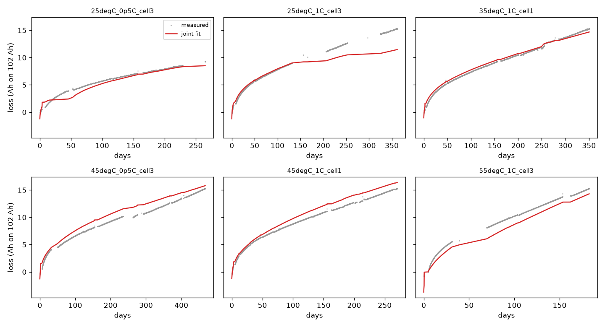

# Stage 2 — Prior from the Challenge 1 cells and the literature (no proxy metric)

> **Language:** English · [中文](#zh)

Protocol: [protocol.json](protocol.json) (SHA256 in [protocol.sha256](protocol.sha256), committed before any cell was loaded). Code: [c1_cycles.py](c1_cycles.py), [fit_prior.py](fit_prior.py), [figure_2.py](figure_2.py). Result: [prior.json](prior.json).

## Data used

All six Challenge 1 cells were used up to the first point where smoothed relative capacity falls below 85 % ([S2_cells_used.csv](outputs/S2_cells_used.csv)). This gives 182–468 days and 0.2–0.5 MAh of throughput per cell.

Measured cell temperatures are well above the nominal chamber values under cycling: medians are about 37–41 °C for the "25 °C" cells, 41 °C at 35 °C, 47–49 °C at 45 °C and 59 °C at 55 °C. The fit therefore uses the measured temperature during cycles and the nominal temperature during idle gaps.

## Fits

- **Joint fit** (shared log A_cal, log A_cyc, z, Ea): z = 0.20, **at its lower bound**; Ea = 57 kJ/mol. The per-cell RMSE is 0.35–1.83 Ah ([S2_joint_residuals.csv](outputs/S2_joint_residuals.csv)); see the figure.
- **Per-cell fits** ([S2_per_cell_fits.csv](outputs/S2_per_cell_fits.csv)): z = 0.42–0.46 for the two 25 °C cells and z = 0.20 (bound) for the other four.
- **Leave-one-cell-out jackknife SDs:** z 0.25, Ea 39 kJ/mol, log A_cal 1.44, log A_cyc 7.0 ([S2_loco_fits.csv](outputs/S2_loco_fits.csv)).

**Reading the fits.**

- The measured curves show a fast first-month loss (3–5 Ah in 30 days) followed by a near-linear phase. The concave t^z term with z ≈ 0.2 takes the fast early part, and the linear cycle term takes the rest.
- During long idle gaps (25 °C 1C cell, days ~130–210; 55 °C cell, days ~30–70) the measured loss jumps by about 1.5–2.5 Ah, but the fitted z = 0.2 term is nearly flat. A single t^z term therefore conflates break-in with storage (calendar) ageing.
- These cells cycle continuously at full depth. Calendar and cycle contributions are not separable in them: the jackknife SD of both log A values exceeds ln 3.

## Prior applied (registered rules)

| Parameter | Prior | Source / rule |
|---|---|---|
| z | N(0.20, 0.253²) | Challenge 1 joint fit; the mean sits at the 0.2 bound (flagged, D2.1) |
| Ea | N(37.3, 6.53²) kJ/mol | Challenge 1 95 % width (152 kJ/mol) exceeds Yagci's 25.6 → Yagci 2025 |
| log A_cal | N(0.830, ln 3²), i.e. A_cal ≈ 2.29 Ah/d^0.2 | identifiability fallback: Yagci-derived at z = 0.2, Ea = 37.3 |
| log A_cyc | N(−11.75, ln 3²), i.e. A_cyc ≈ 7.9 × 10⁻⁶ per Ah | identifiability fallback: Yagci-derived |

**Sanity check against Yagci 2025** (agreement factors only, nothing tuned): calendar loss is predicted at 1.25× (35 °C) and 0.80× (50 °C) of the published value; cyclic loss at 1.22× and 0.83×. With z fixed at 0.2, the temperature trend is flatter than published.

## Consequence for stage 3

S_main fixes z = 0.20 and Ea = 37.3 kJ/mol as registered. Because of the idle-gap diagnostic above, stage 3 registers one additional, report-only variant with z = 0.5 (the classical √t calendar law). It is not counted in G-robust and is never promoted.

---

# 第 2 阶段——由 Challenge 1 电芯和文献构建先验（不算代理指标）

> **语言：** [English](#en) · 中文

协议：[protocol.json](protocol.json)（SHA256 见 [protocol.sha256](protocol.sha256)，在加载任何电芯之前提交）。代码：[c1_cycles.py](c1_cycles.py)、[fit_prior.py](fit_prior.py)、[figure_2.py](figure_2.py)。结果：[prior.json](prior.json)。

## 使用的数据

六枚 Challenge 1 电芯全部使用，截到平滑相对容量首次低于 85 % 为止（[S2_cells_used.csv](outputs/S2_cells_used.csv)）。每枚电芯有 182–468 天、0.2–0.5 MAh 的吞吐。

循环时实测芯温远高于箱温标称值：标为 25 °C 的电芯中位数约 37–41 °C，35 °C 为 41 °C，45 °C 为 47–49 °C，55 °C 为 59 °C。所以拟合中循环期间用实测温度，空闲间隔用标称温度。

## 拟合

- **联合拟合**（共享 log A_cal、log A_cyc、z、Ea）：z = 0.20，**落在下界**；Ea = 57 kJ/mol。逐芯 RMSE 0.35–1.83 Ah（[S2_joint_residuals.csv](outputs/S2_joint_residuals.csv)），见图。
- **逐芯拟合**（[S2_per_cell_fits.csv](outputs/S2_per_cell_fits.csv)）：两枚 25 °C 电芯 z = 0.42–0.46，其余四枚 z = 0.20（下界）。
- **留一芯 jackknife SD：** z 0.25，Ea 39 kJ/mol，log A_cal 1.44，log A_cyc 7.0（[S2_loco_fits.csv](outputs/S2_loco_fits.csv)）。

**如何解读这些拟合。**

- 实测曲线先是首月快速损失（30 天内 3–5 Ah），之后接近线性。z ≈ 0.2 的凹形 t^z 项承担了早期的快速部分，线性循环项承担其余部分。
- 在长时间停测的空档里（25 °C 1C 电芯约第 130–210 天；55 °C 电芯约第 30–70 天），实测损失跳升约 1.5–2.5 Ah，而拟合的 z = 0.2 项几乎是平的。所以单一的 t^z 项把磨合与存储（日历）老化混在了一起。
- 这些电芯是连续满深度循环，日历与循环贡献在其中分不开：两个 log A 的 jackknife SD 都超过 ln 3。

## 采用的先验（按登记的规则）

| 参数 | 先验 | 来源 / 规则 |
|---|---|---|
| z | N(0.20, 0.253²) | Challenge 1 联合拟合；均值落在 0.2 下界（已标注，D2.1） |
| Ea | N(37.3, 6.53²) kJ/mol | Challenge 1 的 95 % 宽度（152 kJ/mol）超过 Yagci 的 25.6 → 用 Yagci 2025 |
| log A_cal | N(0.830, ln 3²)，即 A_cal ≈ 2.29 Ah/d^0.2 | 可辨识性回退：在 z = 0.2、Ea = 37.3 下由 Yagci 推出 |
| log A_cyc | N(−11.75, ln 3²)，即 A_cyc ≈ 7.9 × 10⁻⁶ /Ah | 可辨识性回退：由 Yagci 推出 |

**与 Yagci 2025 的合理性检查**（只报告吻合倍数，没有调参）：日历损失的预测值是公布值的 1.25 倍（35 °C）和 0.80 倍（50 °C）；循环损失为 1.22 倍和 0.83 倍。z 固定为 0.2 时，温度趋势比公布的平缓。

## 对第 3 阶段的影响

S_main 按登记固定 z = 0.20、Ea = 37.3 kJ/mol。鉴于上面的空档诊断，第 3 阶段额外登记一个仅报告的变体 z = 0.5（经典 √t 日历律）。它不计入 G-robust，也绝不升为主配置。
