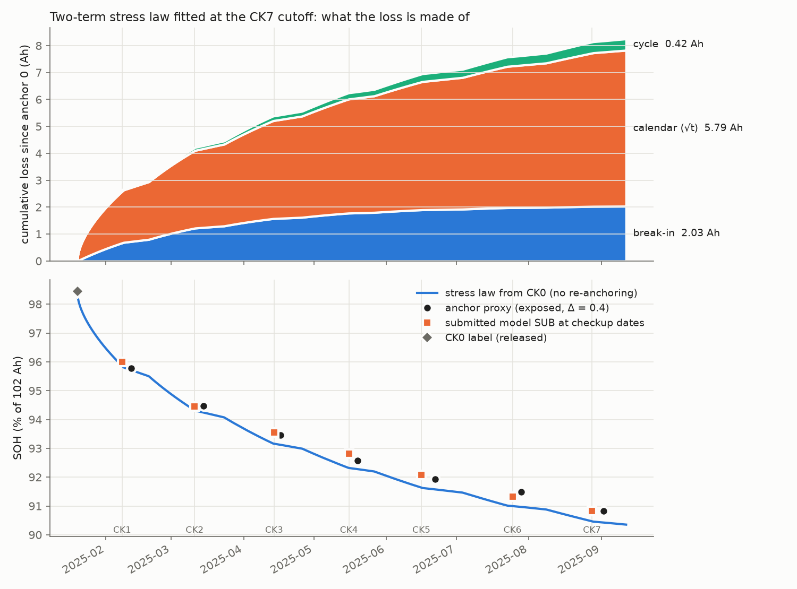

# Draft — Interpretability: what the capacity loss is made of

> **Language:** English · [中文](#zh)

The stress law, fitted on the anchors visible at the CK7 cutoff (two-term law, Arrhenius-weighted time and throughput, Challenge 1 / Yagci prior), splits the 8.2 Ah lost between anchor 0 and the end of the campaign into three parts ([table](fig_stress_law_decomposition_table.csv)):

| Component | Parameter | Loss to campaign end |
|---|---|---|
| break-in A_b (1 − e^(−τ/τ_b)) | A_b = 2.10 Ah, τ_b = 134 effective days | 2.03 Ah |
| calendar A_cal √τ | A_cal = 0.266 Ah/d^0.5 | 5.79 Ah |
| cycle A_cyc · ah | A_cyc = 6.1 × 10⁻⁶ per Ah | 0.42 Ah |

**How to read it.**

- The pack sits mostly at 45 °C in a storage-like profile, so time at temperature (break-in + calendar) dominates.
- The lower panel shows that one law, integrated from the CK0 label without re-anchoring, follows the anchors to within 0.2–0.5 pp. The submitted model re-anchors every month and tracks them more closely.
- **Caveat.** The calendar/cycle split is not identifiable from this pack alone: the daily duty repeats, so time and throughput rise together, and the split follows the prior. In round 5A, a different prior put most of the loss in the cycle term. The total and the break-in shape are robust; the split is an interpretation.

---

# 草稿——可解释性：容量损失由什么构成

> **语言：** [English](#en) · 中文

应力定律用 CK7 截断时可见的锚点拟合（两项定律，时间和吞吐都按 Arrhenius 加权，先验来自 Challenge 1 / Yagci），把锚点 0 到试验结束之间损失的 8.2 Ah 分成三部分（[表格](fig_stress_law_decomposition_table.csv)）：

| 分量 | 参数 | 到试验结束的损失 |
|---|---|---|
| 磨合 A_b (1 − e^(−τ/τ_b)) | A_b = 2.10 Ah，τ_b = 134 有效天 | 2.03 Ah |
| 日历 A_cal √τ | A_cal = 0.266 Ah/d^0.5 | 5.79 Ah |
| 循环 A_cyc · ah | A_cyc = 6.1 × 10⁻⁶ /Ah | 0.42 Ah |

**怎么读这张图。**

- 电池组大部分时间在 45 °C 下以类似储能的工况运行，所以在温度下度过的时间（磨合 + 日历）占主导。
- 下图显示，同一条定律从 CK0 标签起积分、不重新锚定，与各锚点相差 0.2–0.5 pp。提交的模型每个月重新锚定，跟踪得更紧。
- **注意。** 仅靠本电池组无法辨识日历与循环的划分：每天的工况重复，时间和吞吐一起增长，划分结果跟着先验走。在第五轮 A 中，换一个先验，大部分损失就被归给了循环项。总损失和磨合的形状是稳健的；划分只是一种解读。
