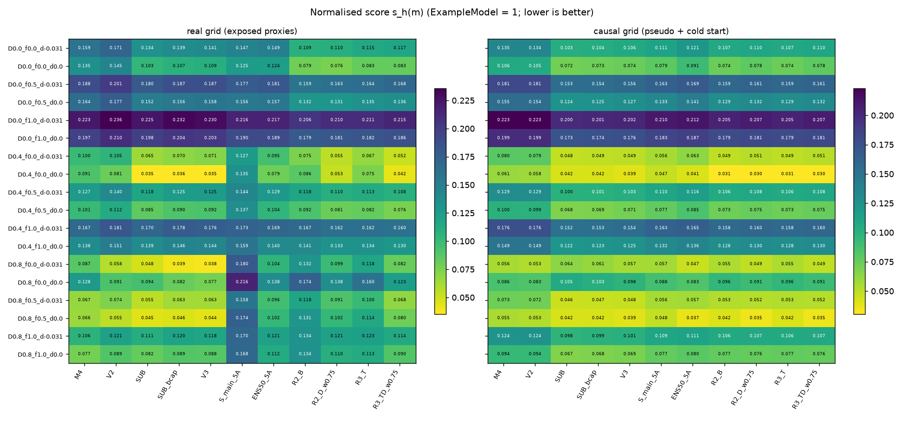

# WP1 — Hypothesis-robust selection among existing models

> **Language:** English · [中文](#zh)

- **Protocol:** [protocol.json](protocol.json) (SHA256 in [protocol.sha256](protocol.sha256)), committed `8a08025` before any score. Code: [run_wp1.py](run_wp1.py).
- **Exposure:** real-grid values use exposed proxies. WP1 measures robustness to **label** uncertainty; it is not new evidence of accuracy.

## Conclusions first

1. **Registered robust choice on the real grid: SUB (the submitted V2+√t).**
   - It has the lowest max regret (0.027 normalised units, where ExampleModel = 1).
   - SUB_bcap (0.032) and V3 (0.033) are tied with it within the registered 0.01 window; SUB wins the tie-break on the diagnosis-prior expectation (0.0952 vs 0.0969 / 0.0966).
2. **The 5C stress ensembles are close and complementary.** R3_TD_w0.75 has the best worst case (0.215 vs SUB 0.225) and the best uniform-prior expectation (0.1128 vs 0.1134). Its max regret (0.047) comes from the hypotheses with truth Δ = 0.8, where SUB is better.
   - Stress-based models win when the true anchor offset is small (Δ = 0 or 0.4) or the "recovery" is partly unseen (f > 0).
   - SUB wins when the true Δ is 0.8.
   - This complementarity is the motivation for WP2's fusion.
3. **On the causal grid** (pseudo + cold start), the stress ensembles have the lowest max regret (R3_TD_w0.75 and R2_D_w0.75: 0.0093; SUB: 0.022). But the registered 0.01 tie window makes seven models tie, and the tie-break picks V3 on a 0.0833 vs 0.0835 expectation.
   - The real and causal grids therefore **disagree** (SUB vs V3).
   - The registered tie window is too wide for this scale (D1.1). Read literally, the causal grid favours the stress ensembles.
4. **The label hypotheses dominate the model choice.**
   - Under f = 1 (the hidden C/20 misses the full round-4 "recovery"), every model's maximum error is 1.2–1.6 pp at Δ = 0, against 0.2–0.4 pp under f = 0.
   - Within a hypothesis, the spread between our models is mostly below 0.05 normalised units.
   - So the f and Δ hypotheses, which only the leaderboard can test, matter more than the model.

## Decision table

Normalised score s = mean(MAE, RMSE, MAX ratios to ExampleModel); lower is better. The full table, including causal columns, is in [outputs/wp1_decision_table.csv](outputs/wp1_decision_table.csv).

| Model | Worst s | Max regret | E (uniform) | E (diagnosis prior) | s at Δ 0.4, f 0, d 0 | Causal max regret | Causal E (diagnosis) |
|---|---|---|---|---|---|---|---|
| **SUB** | 0.225 | **0.027** | 0.1134 | **0.0952** | 0.035 | 0.022 | 0.0836 |
| SUB_bcap | 0.232 | 0.032 | 0.1172 | 0.0969 | 0.036 | 0.019 | 0.0837 |
| V3 | 0.230 | 0.033 | 0.1166 | 0.0966 | 0.035 | 0.015 | 0.0833 |
| R3_TD_w0.75 (exposed-CK1) | **0.215** | 0.047 | **0.1128** | 0.0966 | 0.042 | **0.009** | 0.0835 |
| M4 (V1) | 0.223 | 0.059 | 0.1291 | 0.1210 | 0.091 | 0.034 | 0.1030 |
| R2_D_w0.75 | 0.210 | 0.061 | 0.1181 | 0.1023 | 0.053 | **0.009** | 0.0835 |
| ENS50 (5A) | 0.217 | 0.066 | 0.1338 | 0.1233 | 0.079 | 0.019 | 0.0898 |
| V2 | 0.236 | 0.069 | 0.1333 | 0.1196 | 0.081 | 0.034 | 0.1018 |
| R3_T (exposed-CK1) | 0.211 | 0.083 | 0.1249 | 0.1125 | 0.075 | 0.013 | 0.0834 |
| R2_B | 0.206 | 0.097 | 0.1314 | 0.1190 | 0.087 | 0.013 | 0.0834 |
| S_main (5A) | 0.216 | 0.142 | 0.1640 | 0.1583 | 0.135 | 0.017 | 0.0878 |

- **Ranking stability.** By max regret: SUB > SUB_bcap > V3 > R3_TD. By uniform expectation: R3_TD > SUB > V3 > SUB_bcap. By diagnosis expectation: SUB > V3 ≈ R3_TD > SUB_bcap.
- **Best model per hypothesis** (18 hypotheses): R3_TD_w0.75 ×5, R2_B ×4, V3 ×3, R2_D_w0.75 ×2, SUB ×2, M4 ×2 ([JSON](outputs/wp1_choice.json)).
- Exposed checkpoints: SUB, SUB_bcap and V3 at CK2 (√t); R3_* at CK1.

Raw MAE and MAX per hypothesis: [MAE](outputs/wp1_rawMAE_real_by_h.csv), [MAX](outputs/wp1_rawMAX_real_by_h.csv). Regret per hypothesis: [CSV](outputs/wp1_regret_real_by_h.csv). Round-4 R_k used: 0.018, 0.245, 0.336, 0.707, 0.827, 0.798, 0.866 Ah.

## What this means for the next WPs

- Keeping SUB is the registered robust choice; no switch is supported by WP1.
- WP2 should try to combine SUB's strength at large Δ with the stress models' strength elsewhere, and G-hyp (max regret ≤ SUB's 0.027) is a demanding gate.
- WP3's ε-drift and start-state corrections move exactly the axes (d, Δ) that dominate here.

---

# WP1——在现有模型中做多假设稳健选择

> **语言：** [English](#en) · 中文

- **协议：** [protocol.json](protocol.json)（SHA256 见 [protocol.sha256](protocol.sha256)），在计算任何得分之前于 `8a08025` 提交。代码：[run_wp1.py](run_wp1.py)。
- **曝光：** 真实网格用的是已曝光的代理。WP1 衡量的是对**标签**不确定性的稳健性，不是关于精度的新证据。

## 结论先读

1. **按登记规则，真实网格上的稳健选择是 SUB（当前提交的 V2+√t）。**
   - 它的最大后悔值最低（0.027，归一化单位，ExampleModel = 1）。
   - SUB_bcap（0.032）和 V3（0.033）在登记的 0.01 范围内与它并列；按依据诊断的先验期望决胜，SUB 胜出（0.0952 对 0.0969 / 0.0966）。
2. **5C 的应力集成与它很接近，而且互补。** R3_TD_w0.75 的最坏情况最好（0.215 对 SUB 的 0.225），均匀先验下的期望也最好（0.1128 对 0.1134）。它的最大后悔值（0.047）来自真值 Δ = 0.8 的那些假设，在那里 SUB 更好。
   - 当真实的锚点偏移较小（Δ = 0 或 0.4），或"恢复量"有一部分没被测到（f > 0）时，基于应力的模型胜出。
   - 当真实 Δ 为 0.8 时，SUB 胜出。
   - 这种互补正是 WP2 做融合的动机。
3. **在因果网格上**（伪场景 + 冷启动），应力集成的最大后悔值最低（R3_TD_w0.75 和 R2_D_w0.75：0.0093；SUB：0.022）。但登记的 0.01 并列阈值让七个模型都成了并列，决胜时按期望（0.0833 对 0.0835）选中了 V3。
   - 因此真实网格和因果网格的结论**不一致**（SUB 对 V3）。
   - 对这个尺度来说，登记的并列阈值太宽了（D1.1）。如果直接看数值，因果网格更偏向应力集成。
4. **标签假设比模型选择更重要。**
   - 在 f = 1（隐藏的 C/20 完全没测到第四轮的"恢复量"）时，Δ = 0 下每个模型的最大误差都是 1.2–1.6 pp；而 f = 0 时只有 0.2–0.4 pp。
   - 在同一个假设下，我们各模型之间的差距大多小于 0.05 个归一化单位。
   - 所以只有排行榜才能检验的 f 和 Δ 假设，比选哪个模型更关键。

## 决策表

归一化得分 s = mean(MAE、RMSE、MAX 与 ExampleModel 之比)，越低越好。完整表格（含因果列）见 [outputs/wp1_decision_table.csv](outputs/wp1_decision_table.csv)。

| 模型 | 最坏 s | 最大后悔值 | 期望（均匀） | 期望（诊断先验） | Δ 0.4、f 0、d 0 时的 s | 因果最大后悔值 | 因果期望（诊断先验） |
|---|---|---|---|---|---|---|---|
| **SUB** | 0.225 | **0.027** | 0.1134 | **0.0952** | 0.035 | 0.022 | 0.0836 |
| SUB_bcap | 0.232 | 0.032 | 0.1172 | 0.0969 | 0.036 | 0.019 | 0.0837 |
| V3 | 0.230 | 0.033 | 0.1166 | 0.0966 | 0.035 | 0.015 | 0.0833 |
| R3_TD_w0.75（已曝光 CK1） | **0.215** | 0.047 | **0.1128** | 0.0966 | 0.042 | **0.009** | 0.0835 |
| M4（V1） | 0.223 | 0.059 | 0.1291 | 0.1210 | 0.091 | 0.034 | 0.1030 |
| R2_D_w0.75 | 0.210 | 0.061 | 0.1181 | 0.1023 | 0.053 | **0.009** | 0.0835 |
| ENS50（5A） | 0.217 | 0.066 | 0.1338 | 0.1233 | 0.079 | 0.019 | 0.0898 |
| V2 | 0.236 | 0.069 | 0.1333 | 0.1196 | 0.081 | 0.034 | 0.1018 |
| R3_T（已曝光 CK1） | 0.211 | 0.083 | 0.1249 | 0.1125 | 0.075 | 0.013 | 0.0834 |
| R2_B | 0.206 | 0.097 | 0.1314 | 0.1190 | 0.087 | 0.013 | 0.0834 |
| S_main（5A） | 0.216 | 0.142 | 0.1640 | 0.1583 | 0.135 | 0.017 | 0.0878 |

- **排名的稳定性。** 按最大后悔值：SUB > SUB_bcap > V3 > R3_TD。按均匀先验期望：R3_TD > SUB > V3 > SUB_bcap。按诊断先验期望：SUB > V3 ≈ R3_TD > SUB_bcap。
- **各假设下的最佳模型**（共 18 个假设）：R3_TD_w0.75 ×5、R2_B ×4、V3 ×3、R2_D_w0.75 ×2、SUB ×2、M4 ×2（[JSON](outputs/wp1_choice.json)）。
- 已曝光的检查点：SUB、SUB_bcap、V3 在 CK2（√t）；R3_* 在 CK1。

各假设下的原始 MAE 和 MAX：[MAE](outputs/wp1_rawMAE_real_by_h.csv)、[MAX](outputs/wp1_rawMAX_real_by_h.csv)。各假设下的后悔值：[CSV](outputs/wp1_regret_real_by_h.csv)。所用的第四轮 R_k：0.018、0.245、0.336、0.707、0.827、0.798、0.866 Ah。

## 对后续工作包的意义

- 保留 SUB 是登记的稳健选择；WP1 不支持更换。
- WP2 应尝试把 SUB 在大 Δ 下的优势与应力模型在其他情形下的优势结合起来；G-hyp（最大后悔值 ≤ SUB 的 0.027）是一道很高的门槛。
- WP3 的 ε 漂移和起点修正，作用的正是这里起决定作用的两个轴（d 和 Δ）。
